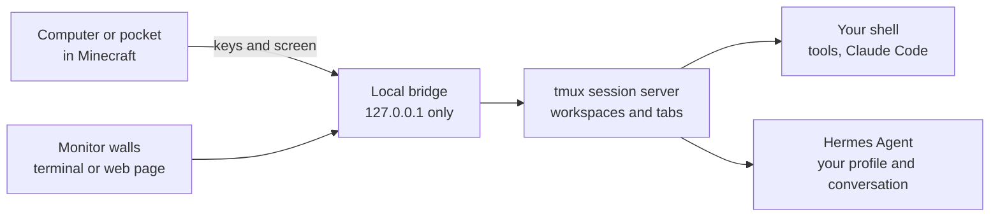

  

  &nbsp;
  &nbsp;
  &nbsp;
  &nbsp;
   
  ⭐ Star the repo to follow the build

Hermes Agent · Claude Code · Minecraft Java 26.2 · Linux, macOS, Windows (WSL2) · MIT

 

Most AI agents live in a pile of terminal tabs. In **Omo Space**, every agent
gets a desk in a world you build. Place a computer and a real Hermes Agent
session, or a shell for Claude Code, starts on your own machine. Its terminal
goes on the wall, real web pages go on the monitors, and the work keeps running
after you walk away, or quit the game.

## Watch: the whole loop, live

On 27 October a viewer found one of our reels on Instagram and dropped into the
live stream. Yifan, who builds Omo Space, stopped what he was doing and walked
him through everything: the rooms, the agents, the edit review, the publishing
desk, and then one prompt that built an underground robotics lab while they
talked. 15 minutes, one take.

**[▶ Watch the demo](https://github.com/omoresearch/omo-space/releases/tag/demo-2026-10-27)** ·
[download the MP4](https://github.com/omoresearch/omo-space/releases/download/demo-2026-10-27/omo-space-demo-2026-10-27.mp4) (1080p, 346 MB) ·
[read the transcript](docs/demo/TRANSCRIPT.md)

> *"Any product or idea goes from this terminal here, which is just a Hermes,
> into the references room, and it finds us the top references of the most
> viral videos. After we choose, it tells us what we need to record, in this
> room. Once that's done, we go to the editing room, and we have the edits that
> we can just review here."*
>
> *"The robots did all of that. I'm not doing much. I'm just connecting my API
> call, and then doing a few basic prompts over time."*
>
> — Yifan, on stream ([1:03](docs/demo/TRANSCRIPT.md#103--the-loop-end-to-end))

## Inside the world

Every room is an agent at its own desk. You walk up, type into the wall, and it
answers on the wall. These loops are cut straight from that stream.

<table>
<tr>
<td width="33%"></td>
<td width="33%"></td>
<td width="33%"></td>
</tr>
<tr>
<td valign="top"><b>01 · Find</b> "It finds us the top references of the most viral videos."</td>
<td valign="top"><b>02 · Review</b> "We have the edits that we can just review here."</td>
<td valign="top"><b>03 · Publish</b> "This page will always be here, whenever we want to publish things."</td>
</tr>
<tr>
<td></td>
<td></td>
<td></td>
</tr>
<tr>
<td valign="top"><b>One prompt, one lab</b> "I want to see the glass water above us." It built the lab under the river.</td>
<td valign="top"><b>Agents in the halls</b> An agent player you can talk to, walking the same world.</td>
<td valign="top"><b>Build in space</b> "Any time I want to work on the robotics project, I just fly down here."</td>
</tr>
</table>

The rooms, the video pipeline and the agent player are Yifan's own builds
on top of Omo Space. The repo ships the blocks, terminals, web walls and the
local bridge they run on.

## Made by the loop

Reels the rooms found, cut and published on [Instagram](https://www.instagram.com/yifanexperimenting/),
from clips of the stream.

<table>
<tr>
<td width="25%"></td>
<td width="25%"></td>
<td width="25%"></td>
<td width="25%"></td>
</tr>
</table>

## What you build with

| Block | What it does |
| --- | --- |
| **Hermes Computer** | One named workspace with a Hermes conversation in the profile you choose. Give different agents different desks. |
| **Terminal** | A persistent shell for tools, scripts or Claude Code, without starting a Hermes agent. |
| **Omo Monitor / Slim Screen** | A bigger view of a terminal, or a real Chromium web page pinned to the wall: docs, a dashboard, your project. |
| **Omo Linker** | Mirror a station onto walls across the room, no wiring. |
| **Omo Pocket** | Carry a Hermes or Terminal workspace on an item. |
| **Name Plate / Status Lamp** | A name and a live working / idle / interrupted light. Status also drives redstone. |

**It keeps running.** tmux owns every session. Close the screen, walk to
another chunk or quit Minecraft: the work continues while your PC is awake.
Come back and it's on the wall where you left it. After a reboot, Omo marks the
desk as interrupted and offers to resume the saved Hermes conversation. It
never replays a command on its own.

## Run it

The code is public and MIT licensed.

1. Read [docs/PLATFORMS.md](docs/PLATFORMS.md). Linux x86_64 is tested end to
   end; macOS and Windows (WSL2) support is new and not yet tested on real
   hardware.
2. Download the bundle for your platform and the installer from the
   [latest release](https://github.com/omoresearch/omo-space/releases/latest)
   (`SHA256SUMS` covers every file), then run
   `bash install.sh omo-research-<version>-linux-x64.tar.gz` (or the macOS
   tarball; `install.ps1` with the Windows zip).
   Or build from source with [CONTRIBUTING.md](CONTRIBUTING.md#build-and-test)
   and the [install guide](docs/GUIDE.md#install).
   Either way the launcher downloads Minecraft 26.2, Fabric, CC: Tweaked, MCEF
   and Java from their official sources, with pinned hashes, into its own
   folder. It never touches your own Minecraft or Prism installs.
3. You need your own Minecraft Java account, Python 3.11+, and about 2 GB free.
   Hermes Agent is optional (plain terminals work without it); model access is
   your own.

Stuck, or want a build? Write to [harry@omo.space](mailto:harry@omo.space?subject=Omo%20Space)
or ask on the [live stream](https://www.twitch.tv/yiifannn).

## Questions

**Real agents, or a Minecraft simulation?** Real. Hermes runs on your machine
with its own profiles, memory, tools and approval prompts, and so does anything
you start in a shell. The mod sends your keys to them and paints their terminal
in the game.

**Does it survive quitting the game?** Yes, while your PC stays awake and the
session service runs. A reboot ends the processes; a saved Hermes conversation
can be resumed, in-flight shell commands can't.

**Are the web pages live?** Yes, while the game is open. The pinned page comes
back after a restart; its in-page state doesn't.

**Can another player use my shell?** This is for singleplayer and trusted local
worlds. A block is not a security sandbox. Read the [security model](SECURITY.md)
first.

## For builders

The repo holds the Fabric mod, the Python bridge, the tmux session server, the
launcher, world kits, an example workshop, tests and a bundle builder.

[Controls and commands](docs/GUIDE.md) ·
[Agents and terminals](docs/AGENTS-AND-TERMINALS.md) ·
[Building guide](docs/builders/README.md) ·
[Building maps with Claude Code](docs/MAPS.md) ·
[Platforms](docs/PLATFORMS.md) ·
[Release checklist](docs/RELEASE-CHECKLIST.md) ·
[Contributing](CONTRIBUTING.md)

   
  ⭐ Star the repo to follow the build

---

Code: [MIT](LICENSE). [Third-party notices](THIRD_PARTY_NOTICES.md) cover
CC: Tweaked, MCEF Modern, Fabric, Prism, tmux and bundled Python packages.
Hermes Agent is by Nous Research.

**NOT AN OFFICIAL MINECRAFT PRODUCT. NOT APPROVED BY OR ASSOCIATED WITH MOJANG
OR MICROSOFT.** Minecraft is a trademark of Mojang/Microsoft.

<a href="https://omo.sh">Omo Research</a> · <i>The next interface isn't a chat window.</i>

