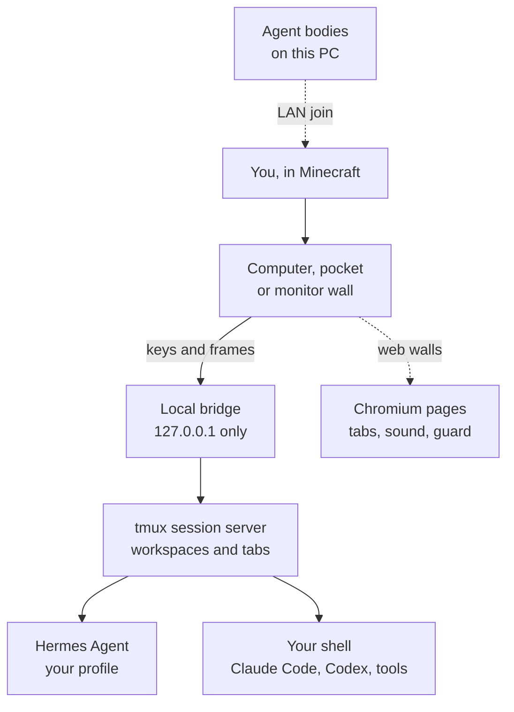

<p align="center">
  
</p>

Most AI agents live in a pile of terminal tabs. In **Omo Space**, every agent gets a desk in a world you build:
place a computer and a real Hermes Agent, Claude Code, Codex or plain shell starts on your own machine, and keeps working after you quit the game.

<p align="center">
  <a href="https://github.com/omoresearch/omo-space/releases/tag/demo-2026-10-27"></a>&nbsp;
  <a href="#run-it"></a>&nbsp;
  <a href="https://www.twitch.tv/yiifannn"></a>&nbsp;
  <a href="https://omo.sh"></a>
</p>

<p align="center">
  <a href="https://github.com/omoresearch/omo-space/releases/latest"></a>
  <a href="https://github.com/omoresearch/omo-space/actions/workflows/ci.yml"></a>
  
  
  <a href="LICENSE"></a>
</p>

## The demo

<a href="https://github.com/omoresearch/omo-space/releases/tag/demo-2026-10-27">
  
</a>

A viewer found one of our reels on Instagram and dropped into the stream, so Yifan walked him through the
rooms, the agents, the edit review and the publishing desk, then built an underground robotics lab from one
prompt while they talked. 15 minutes, one take.

**[▶ Watch](https://github.com/omoresearch/omo-space/releases/tag/demo-2026-10-27)** ·
[MP4](https://github.com/omoresearch/omo-space/releases/download/demo-2026-10-27/omo-space-demo-2026-10-27.mp4) (1080p, 345 MB) ·
[transcript](docs/demo/TRANSCRIPT.md)

<table>
<tr>
<td width="33%"></td>
<td width="33%"></td>
<td width="33%"></td>
</tr>
<tr>
<td></td>
<td></td>
<td></td>
</tr>
</table>
<p align="center"><sub>Find references · review the cut · publish · one prompt, one lab · the robot lab · an agent in the halls. All clips from the stream.</sub></p>

## How it works

1. **Place a desk.** A Hermes Computer or Terminal block opens a named workspace on your PC.
2. **Type on the wall.** Your keys go to a real shell or agent; its terminal is painted in the world. Tabs come from the **+** menu.
3. **Walk away.** tmux owns every session. Close the screen or quit Minecraft and the work continues while your PC is awake.
4. **Come back.** It's on the wall where you left it. After a reboot, walking up to a desk reopens its tabs (shells in their last folder, Hermes on its own conversation). Nothing is ever re-run.

## What you can build

| Block | What it does |
| --- | --- |
| **Hermes Computer** | One named workspace with a Hermes conversation in the profile you choose. Different agents, different desks. |
| **Terminal** | A persistent shell with Shell and Hermes tabs. **Claude Code** and **Codex** tabs are on `main` ([#8](https://github.com/omoresearch/omo-space/pull/8)) and ship in the next release. [Docs](docs/AGENTS-AND-TERMINALS.md#claude-code-and-codex-tabs) |
| **Omo Monitor / Slim Screen** | A bigger view of a terminal, or a real Chromium page on the wall: up to 6 tabs, its own sound, WASD for web games, 12 pages at once, with a guard against runaway pages. |
| **Omo Linker** | Mirror a station onto walls across the room, no wiring. |
| **Omo Pocket** | Carry a Hermes or Terminal workspace on an item. |
| **Name Plate / Status Lamp** | A name and a live working / idle / interrupted light. Status also drives redstone. |

What changed in each release: [changelog](CHANGELOG.md).

## Agents walking in

Since v1.2.0 your single-player world opens to LAN for AI agents running on *this* computer (port 25566).
They join as real players with the Omo skin and a `ChatGPT - <name>` tag; offline logins from other machines
are refused. [How it works](docs/AGENTS-AND-TERMINALS.md#8-agent-bodies-in-your-world-lan-join)

Built on it, live on stream: [Omo, brought to life](https://github.com/omoresearch/omo-brought-to-life)
(talk out loud to an agent that plays in your world) and [Omo Microduck](https://github.com/omoresearch/omo-microduck)
(Pollen Robotics' open robot duck, simulated in MuJoCo, walking on your blocks).

## Run it

1. Read [docs/PLATFORMS.md](docs/PLATFORMS.md). Linux x86_64 is tested end to end; macOS and Windows (WSL2)
   support is new and tested offline only. A clean-machine install through Microsoft sign-in is not tested yet.
2. Grab the installer and the bundle for your platform from the
   [v1.2.0 release](https://github.com/omoresearch/omo-space/releases/tag/v1.2.0)
   (`SHA256SUMS` there covers every file) and run it:

   ```bash
   # Linux x86_64 (macOS: the -macos.tar.gz, after `brew install tmux python`)
   curl -LO https://github.com/omoresearch/omo-space/releases/download/v1.2.0/install.sh
   curl -LO https://github.com/omoresearch/omo-space/releases/download/v1.2.0/omo-research-1.2.0-linux-x64.tar.gz
   bash install.sh omo-research-1.2.0-linux-x64.tar.gz
   ```

   ```powershell
   # Windows 10/11 (the game runs natively, sessions and Hermes in WSL2)
   powershell -ExecutionPolicy Bypass -File .\install.ps1 omo-research-1.2.0-windows.zip
   ```

   Or build from source with [CONTRIBUTING.md](CONTRIBUTING.md#build-and-test) and the
   [install guide](docs/GUIDE.md#install). The launcher downloads Minecraft 26.2, Fabric, CC: Tweaked, MCEF and
   Java from their official sources, with pinned hashes, into its own folder. It never touches your own
   Minecraft or Prism installs.
3. You need your own Minecraft Java account, Python 3.11+ and about 2 GB free. Hermes Agent is optional
   (plain terminals work without it); model access is your own.

Stuck? Write to [harry@omo.space](mailto:harry@omo.space?subject=Omo%20Space) or ask on the
[live stream](https://www.twitch.tv/yiifannn).

## FAQ

<details>
<summary><b>Real agents, or a Minecraft simulation?</b></summary>

Real. Hermes runs on your machine with its own profiles, memory, tools and approval prompts, and so does
anything you start in a shell. The mod sends your keys to them and paints their terminal in the game.
</details>

<details>
<summary><b>Do agents act in the world?</b></summary>

A desk agent works in its terminal on your PC; it doesn't walk or place blocks. An agent *body* (like Omo) is a
separate program that joins over the agent LAN and plays as a player.
</details>

<details>
<summary><b>Does it survive quitting the game?</b></summary>

Yes, while your PC stays awake and the session service runs. A reboot ends the processes; tabs come back when
you next open the desk and a saved Hermes conversation resumes, but in-flight shell commands don't.
</details>

<details>
<summary><b>Are the web pages live?</b></summary>

Yes, while the game is open. Pinned pages come back after a restart; their in-page state doesn't. Chromium here
has no H.264/AAC codecs, so YouTube plays but most Instagram, X and Reddit video doesn't.
</details>

<details>
<summary><b>Can another player use my shell?</b></summary>

This is for singleplayer and trusted local worlds. A block is not a security sandbox. Read the
[security model](SECURITY.md) first.
</details>

## For builders



The bridge listens on loopback only, and a computer's screen holds just a single-use ticket for its own
workspace; the world never stores a credential. The repo holds the Fabric mod, the Python bridge, the tmux
session server, the launcher, world kits, tests and a bundle builder. CI runs the bridge checks against a real
bridge on a disposable tmux server, the launcher tests and the platform tests on Linux, macOS and Windows
(99 bridge checks and 58 launcher tests on [#9](https://github.com/omoresearch/omo-space/pull/9)'s run).

[Guide](docs/GUIDE.md) · [Agents and terminals](docs/AGENTS-AND-TERMINALS.md) ·
[Building](docs/builders/README.md) · [Maps with Claude Code](docs/MAPS.md) ·
[Platforms](docs/PLATFORMS.md) · [Security](SECURITY.md) · [Contributing](CONTRIBUTING.md)

<p align="center">
  <a href="https://github.com/omoresearch/omo-space"></a>
  <br><sub>If an agent at a desk in your own world sounds fun, a star tells us to keep going. We ship on stream almost every day.</sub>
</p>

---

Code: [MIT](LICENSE). [Third-party notices](THIRD_PARTY_NOTICES.md) cover CC: Tweaked, MCEF Modern, Fabric,
Prism, tmux and bundled Python packages. Hermes Agent is by Nous Research.

**NOT AN OFFICIAL MINECRAFT PRODUCT. NOT APPROVED BY OR ASSOCIATED WITH MOJANG OR MICROSOFT.**
Minecraft is a trademark of Mojang/Microsoft.

<p align="center"><sub><a href="https://omo.sh">Omo Research</a></sub></p>
