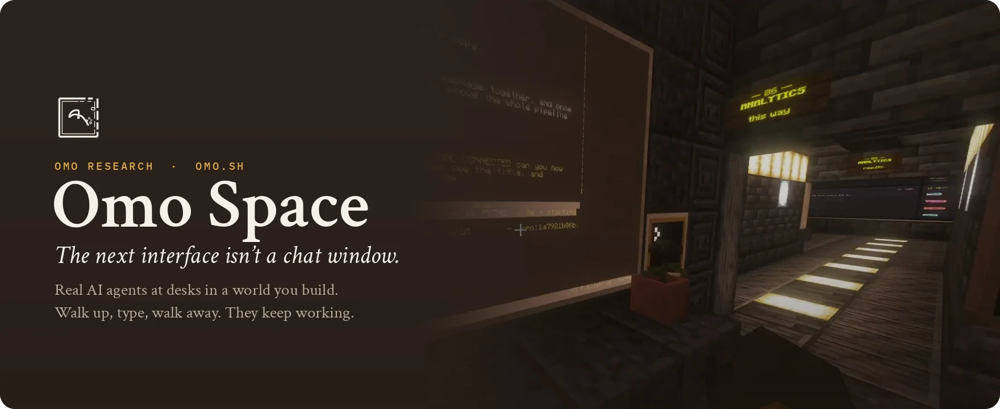
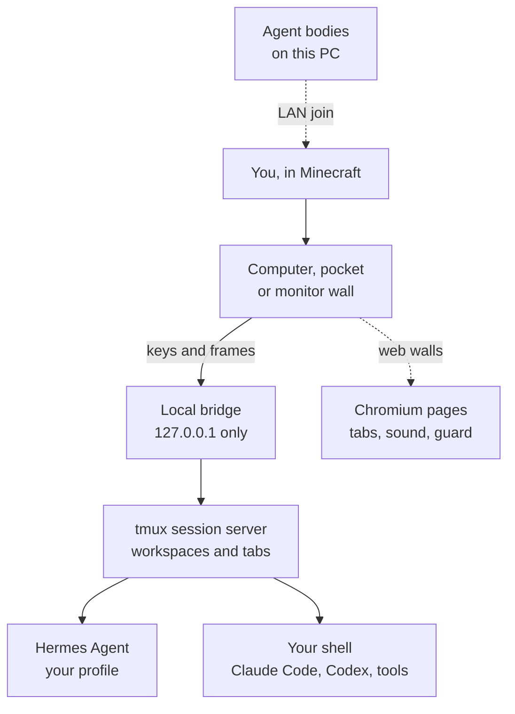

<p align="center">
  
</p>

<p align="center">
  Place a computer in Minecraft and a real <b>Hermes Agent</b>, <b>Claude Code</b>, <b>Codex</b> or plain shell starts on your own machine.<br>
  Its terminal is painted on the wall, real web pages run on the monitors, and the work keeps going after you quit the game.
</p>

<p align="center">
  <a href="https://github.com/omoresearch/omo-space/releases/tag/demo-2026-10-27"></a>&nbsp;
  <a href="#install"></a>&nbsp;
  <a href="https://www.twitch.tv/yiifannn"></a>
</p>

<p align="center">
  <a href="https://github.com/omoresearch/omo-space/releases/latest"></a>
  <a href="https://github.com/omoresearch/omo-space/actions/workflows/ci.yml"></a>
  
  <a href="LICENSE"></a>
</p>

<br>

<a href="https://github.com/omoresearch/omo-space/releases/tag/demo-2026-10-27">
  
</a>

<p align="center"><sub>
  15 minutes, one take, live on stream: the rooms, the agents, the edit review, the publishing desk, and an underground robot lab built from one prompt.<br>
  <a href="https://github.com/omoresearch/omo-space/releases/tag/demo-2026-10-27"><b>Watch</b></a> ·
  <a href="https://github.com/omoresearch/omo-space/releases/download/demo-2026-10-27/omo-space-demo-2026-10-27.mp4">MP4, 1080p, 345 MB</a> ·
  <a href="docs/demo/TRANSCRIPT.md">Transcript</a>
</sub></p>

<p align="center">
  
  
  
  <br>
  
  
  
  <br>
  <sub>Find references · review the cut · publish · one prompt, one lab · the robot lab · an agent in the halls. All clips from the stream.</sub></p>

## How it works

1. **Place a desk.** A Hermes Computer or Terminal block opens a named workspace on your PC.
2. **Type on the wall.** Your keys go to a real shell or agent, and its terminal is painted in the world.
3. **Walk away.** tmux owns every session. Quit Minecraft and the work goes on while your PC is awake.
4. **Come back.** It's on the wall where you left it. After a reboot, the desk reopens its tabs; nothing is re-run.

## What you can build

| Block | What it does |
| --- | --- |
| **Hermes Computer** | A named workspace with its own Hermes conversation. One desk per agent. |
| **Terminal** | A persistent shell with tabs. Claude Code and Codex tabs land in the [next release](docs/AGENTS-AND-TERMINALS.md#claude-code-and-codex-tabs). |
| **Omo Monitor · Slim Screen** | A big wall for a terminal or a real web page, with tabs and sound. |
| **Omo Linker** | Mirror a desk onto walls across the room, no wiring. |
| **Omo Pocket** | Carry a workspace around as an item. |
| **Name Plate · Status Lamp** | A name and a live working / idle / interrupted light that also drives redstone. |

**New in v1.2.0:** agents on your PC can [walk into your world as players](docs/AGENTS-AND-TERMINALS.md#8-agent-bodies-in-your-world-lan-join).
Meet them in [Omo, brought to life](https://github.com/omoresearch/omo-brought-to-life) and [Omo Microduck](https://github.com/omoresearch/omo-microduck).

## Install

**You need:** a Minecraft Java account, Python 3.11 or newer, and about 2 GB of free space.
Omo Space brings its own copy of Minecraft, so your normal Minecraft stays untouched.

> **Tested on:** Linux, end to end. macOS and Windows are new and only tested offline so far,
> and a fresh-machine Microsoft sign-in hasn't been tested yet.

### Linux

**1. Download** the installer, the app and the checksum list:

```bash
curl -LO https://github.com/omoresearch/omo-space/releases/download/v1.2.0/install.sh
curl -LO https://github.com/omoresearch/omo-space/releases/download/v1.2.0/omo-research-1.2.0-linux-x64.tar.gz
curl -LO https://github.com/omoresearch/omo-space/releases/download/v1.2.0/SHA256SUMS
```

**2. Check** the downloads. Both lines should end in `OK`:

```bash
sha256sum -c --ignore-missing SHA256SUMS
```

**3. Install.** This downloads Minecraft, Fabric, the mods and Java (about 650 MB, around 5 minutes):

```bash
bash install.sh omo-research-1.2.0-linux-x64.tar.gz
```

**4. Play.** Open **Omo Space** from your app menu, click **Sign in with Microsoft**, then **Play**.
In the game, find the Omo Space tab in the creative inventory and place a **Hermes Computer** or a **Terminal**.

### macOS

Run `brew install tmux python` first, then follow the Linux steps with two changes:
download `omo-research-1.2.0-macos.tar.gz` instead of the Linux file, and check it with
`shasum -a 256 -c --ignore-missing SHA256SUMS`. Start the app with `omo-research`.

### Windows 10/11

Your shells and agents run in WSL2. Set it up once with the [Windows steps](docs/PLATFORMS.md#windows-wsl2),
then download `install.ps1` and `omo-research-1.2.0-windows.zip` from the
[v1.2.0 release](https://github.com/omoresearch/omo-space/releases/tag/v1.2.0) into one folder, and in PowerShell run:

```powershell
powershell -ExecutionPolicy Bypass -File .\install.ps1 omo-research-1.2.0-windows.zip
```

Then open **Omo Space** from the Start menu.

<details>
<summary><b>Requirements, downloads and troubleshooting</b></summary>

- **Hermes Agent** is optional: plain terminals work without it. Model access is your own.
- **Downloads:** setup fetches about 650 MB (about 1 GB on disk); the in-game browser fetches about 360 MB
  the first time a web wall opens.
- **Ubuntu 22.04:** `sudo apt install python3.11` first (the installer finds it). The Linux window needs
  GTK 4 + libadwaita (`sudo apt install python3-gi gir1.2-gtk-4.0 gir1.2-adw-1`); without them Omo Space
  opens as a menu in a terminal.
- **From source:** [CONTRIBUTING.md](CONTRIBUTING.md#build-and-test) and the [install guide](docs/GUIDE.md#install).
- **Stuck?** Write to [harry@omo.space](mailto:harry@omo.space?subject=Omo%20Space) or ask on the [live stream](https://www.twitch.tv/yiifannn).

</details>

## FAQ

<details>
<summary><b>Real agents, or a Minecraft simulation?</b></summary>

Real. Hermes runs on your machine with its own profiles, memory, tools and approval prompts, and so does
anything you start in a shell. The mod sends your keys to them and paints their terminal in the game.
</details>

<details>
<summary><b>Do agents act in the world?</b></summary>

A desk agent works in its terminal on your PC; it doesn't walk or place blocks. An agent *body* (like Omo) is a
separate program on the same PC that joins your world as a player over LAN port 25566. Logins from other
machines are refused.
</details>

<details>
<summary><b>Does it survive quitting the game?</b></summary>

Yes, while your PC stays awake and the session service runs. A reboot ends the processes; tabs come back when
you next open the desk (shells in their last folder) and a saved Hermes conversation resumes, but in-flight shell
commands don't.
</details>

<details>
<summary><b>Are the web pages live?</b></summary>

Yes, while the game is open: up to 12 pages at once, with a guard against runaway pages. Pinned pages come back
after a restart; their in-page state doesn't. Chromium here has no H.264/AAC codecs, so YouTube plays but most
Instagram, X and Reddit video doesn't.
</details>

<details>
<summary><b>Can another player use my shell?</b></summary>

This is for singleplayer and trusted local worlds. A block is not a security sandbox. Read the
[security model](SECURITY.md) first.
</details>

## For builders



The bridge listens on `127.0.0.1` only and the world never stores a credential. CI tests the bridge, launcher
and platforms on Linux, macOS and Windows.

[Guide](docs/GUIDE.md) · [Agents](docs/AGENTS-AND-TERMINALS.md) · [Building](docs/builders/README.md) ·
[Maps](docs/MAPS.md) · [Platforms](docs/PLATFORMS.md) · [Security](SECURITY.md) · [Contributing](CONTRIBUTING.md) ·
[Changelog](CHANGELOG.md)

<br>

<p align="center">
  <a href="https://github.com/omoresearch/omo-space"></a>
  <br><sub>If an agent at a desk in your own world sounds fun, a star tells us to keep going. We ship on stream almost every day.</sub>
</p>

---

**NOT AN OFFICIAL MINECRAFT PRODUCT. NOT APPROVED BY OR ASSOCIATED WITH MOJANG OR MICROSOFT.**
Minecraft is a trademark of Mojang/Microsoft.

<sub>Code: [MIT](LICENSE). [Third-party notices](THIRD_PARTY_NOTICES.md) cover CC: Tweaked, MCEF Modern, Fabric, Prism, tmux and
bundled Python packages. Hermes Agent is by [Nous Research](https://nousresearch.com), Claude Code by
[Anthropic](https://www.anthropic.com) and Codex by [OpenAI](https://openai.com); Omo Space runs them, it doesn't ship them.
Made by [Omo Research](https://omo.sh).</sub>
