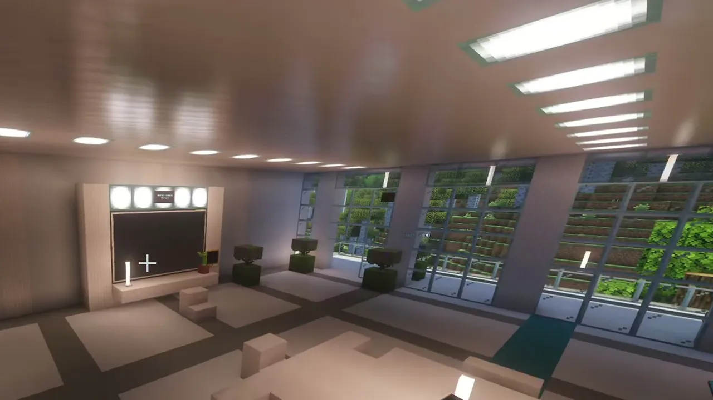
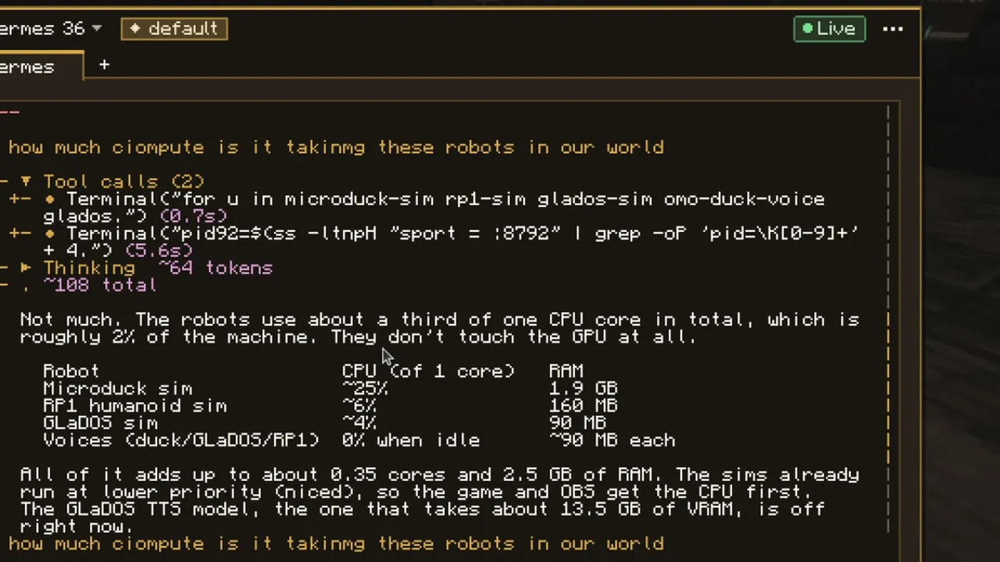
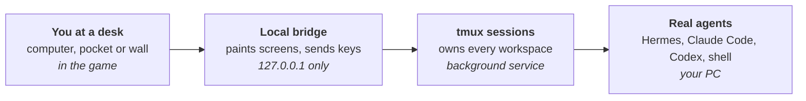
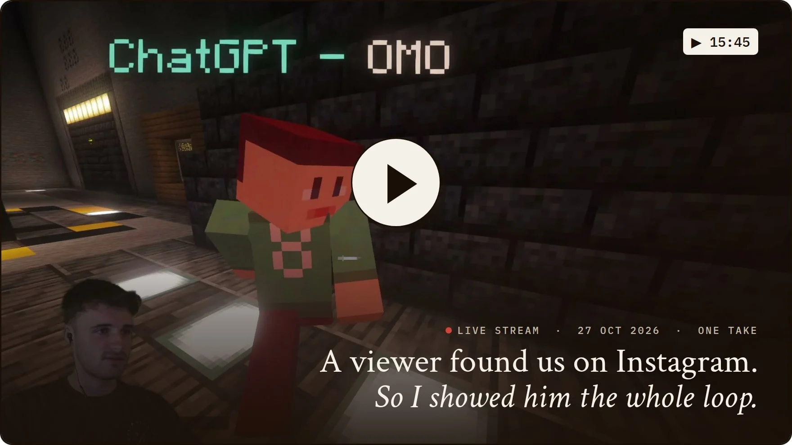
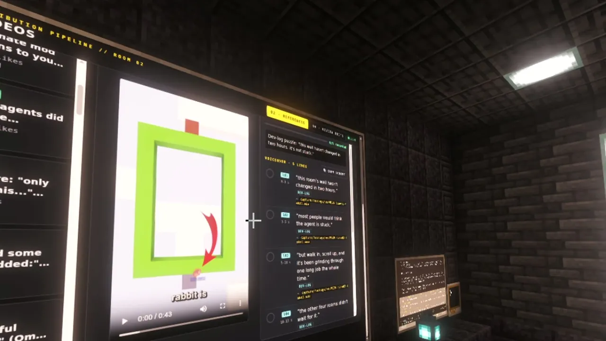
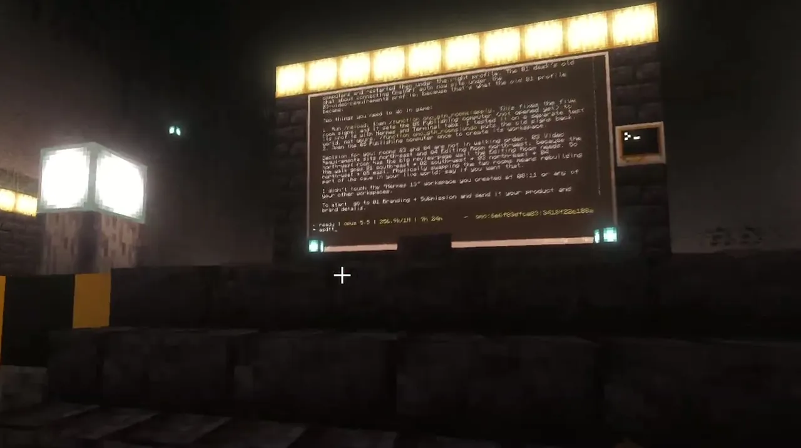
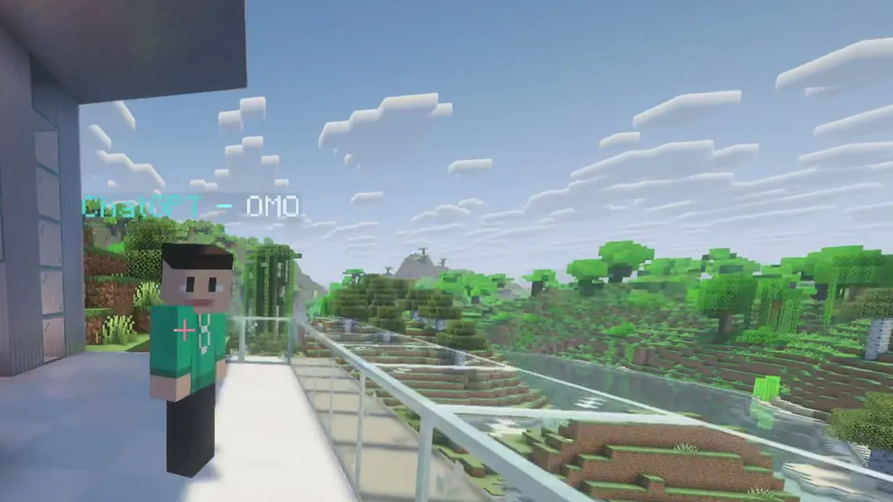
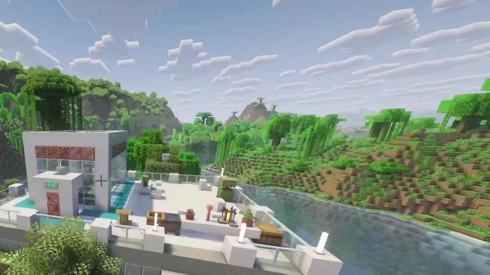

<p align="center">
  <sub><code>System</code> &nbsp; <code>v1.2.0</code> &nbsp; <code>MIT</code> &nbsp; <code>Minecraft Java 26.2</code></sub>
</p>

<h1 align="center"><i>Omo Space</i></h1>

<p align="center">
  Chat windows were built for one conversation. Now there are twenty, and they keep running when you look away.<br>
  <b>So we gave every agent a room.</b>
</p>

<p align="center"><sub>
  Place a computer block in Minecraft and a real Hermes Agent, Claude Code, Codex or plain shell starts on your own PC.<br>
  Its terminal is on the wall, real web pages run on the monitors, and the work keeps going after you quit the game.
</sub></p>

<table align="center">
<tr>
<td align="center"><sub>RELEASE</sub><br><a href="https://github.com/omoresearch/omo-space/releases/tag/v1.2.0">v1.2.0</a>, 28 Oct 2026</td>
<td align="center"><sub>RUNS ON</sub><br>Linux · macOS · Windows (WSL2)</td>
<td align="center"><sub>LICENCE</sub><br><a href="LICENSE">MIT</a></td>
<td align="center"><sub>LIVE</sub><br><a href="https://www.twitch.tv/yiifannn">twitch.tv/yiifannn</a></td>
</tr>
</table>

<p align="center">
  <a href="#install"></a>&nbsp;
  <a href="https://github.com/omoresearch/omo-space/releases/tag/demo-2026-10-27"></a>
  <br><sub>Or let your coding agent do it: <a href="#quick-start-with-your-agent">one prompt to install and build your first world</a>.</sub>
</p>

<p align="center">
  <a href="https://github.com/omoresearch/omo-space"></a>
  <br><sub>Like it? A star helps other builders find it.</sub>
</p>

<p align="center">
  
  <br><sub><code>ILLUSTRATION</code> Generated with ChatGPT image generation. Everything below is real footage from our stream.</sub>
</p>

> **Abstract.** People remember rooms better than tabs. Omo Space gives every long-running agent a place in a shared
> 3D world, so finding one becomes walking to it, resuming becomes coming back to where you left it, and checking on
> the team becomes a glance down the hallway. It is a Minecraft mod and a small local service. Walking away, or
> quitting the game, stops nothing, because the sessions belong to a background session server, not to the game.

<br>

<sub>01</sub>

## Introduction

Most agent interfaces disappear when you close the window. The agent is a tab, the tab looks like every other tab,
and after a dozen of them it is hard to say which one is which, which one is working and which one is waiting for you.

<p><br>
<sub><code>FROM OUR STREAM</code> A hall of desks with screens on the walls, 27 October</sub></p>

Omo Space starts from the opposite end. Each agent gets a place: a desk in a room, with its terminal on the wall and
its name on a plate. You find it by walking to it. You check on it by looking down the hallway. When you come back
the next day, it is where you left it.

<sub>02</sub>

## What you can build

Everything is an ordinary-looking game block. These are the whole kit:

<p><br>
<sub><code>FROM OUR STREAM</code> A real Hermes session on an in-world screen, answering live on stream</sub></p>

| Block | What it does |
| --- | --- |
| **Hermes Computer** | One named workspace with a Hermes conversation in the profile you choose. Different agents, different desks. |
| **Terminal** | A persistent shell. Its "+" menu opens Shell, Hermes, Claude Code or Codex tabs. |
| **Omo Monitor / Slim Screen** | A bigger view of a terminal, or a real Chromium page: up to 6 tabs, its own sound, WASD for web games. |
| **Omo Linker** | Mirrors a station onto walls across the room, with no wiring. |
| **Omo Pocket** | A Hermes or Terminal workspace you carry as an item. |
| **Name Plate / Status Lamp** | A name, and a live working / idle / interrupted light that also drives redstone. |

<sub>Claude Code and Codex tabs are on `main` and ship in the next release ([changelog](CHANGELOG.md)).</sub>

<sub>03</sub>

## How it works

The game is only the view. Four steps describe the whole interaction:



1. **Place a desk.** A Hermes Computer or Terminal block opens a named workspace on your PC.
2. **Type on the wall.** Your keys go to a real shell or agent, and its terminal is painted in the world.
3. **Walk away.** tmux owns every session. Quit Minecraft and the work goes on while your PC is awake.
4. **Come back.** It is on the wall where you left it. After a reboot, the desk reopens its tabs; nothing is re-run.

Web walls are real Chromium pages. Since v1.2.0 a world can show 12 pages at once. A guard rate-limits new pages and
closes all but the nearest walls if memory runs high.

<sub>04</sub>

## What survives what

Persistence is the point, so it is worth being exact about it:

<p><br>
<sub><code>STREAM CLIP</code> Reviewing a cut on the wall: the editing agent's work, where you left it</sub></p>

| Event | Shells and running jobs | Hermes conversation |
| --- | --- | --- |
| Close the screen, walk away | Keep running | Keeps running |
| Quit Minecraft | Keep running | Keeps running |
| Restart the bridge or launcher | Keep running | Keeps running |
| Hermes tab idle and unseen for 20 min | (no change) | Sleeps, saved, and resumes when a screen shows it |
| PC restart | Lost; the tabs come back with the same names, shells in their last folder | Saved, and resumes in its reopened tab |

Two rules hold throughout. State is reported honestly: if the session server stops, the screen says `INTERRUPTED`.
And nothing is re-run on its own: commands that were running are never re-run.

<sub>05</sub>

## What we built with it this week

We use Omo Space as our main workspace, live on stream. Between 25 and 29 October 2026 we ran a content pipeline
from inside the game, with one room per stage: ideas, references, recording, editing, publishing and analytics.
Each room has its own Hermes profile.

<p><a href="https://github.com/omoresearch/omo-space/releases/tag/demo-2026-10-27"></a><br>
<sub><code>▶ DEMO</code> <a href="https://github.com/omoresearch/omo-space/releases/tag/demo-2026-10-27">Watch the 15-minute demo</a>: one take, live on stream · <a href="docs/demo/TRANSCRIPT.md">transcript</a></sub></p>

<table>
<tr>
<td width="50%"><br><sub><code>STREAM CLIP</code> Rooms going up, block by block, from one prompt</sub></td>
<td width="50%"><br><sub><code>STREAM CLIP</code> An underground lab, built from one prompt</sub></td>
</tr>
<tr>
<td width="50%"><br><sub><code>FROM OUR STREAM</code> A pipeline room: one stage, one agent, its work on the wall</sub></td>
<td width="50%"><br><sub><code>FROM OUR STREAM</code> The planning wall in the underground base</sub></td>
</tr>
</table>

The rooms themselves were built by agents: the main underground base, with one room per stage, came from one prompt,
and so did an underground robot lab, live on stream. At the busiest point the builder ran 21 to 25 agent sessions at
once, across 22 separate Hermes profiles.

<p><br>
<sub><code>FROM OUR STREAM</code> An AI agent joins the world as a player and follows you around</sub></p>

Since v1.2.0, agents running on the same computer can also join the world as players, over a LAN port that refuses
offline logins from other machines ([how](docs/AGENTS-AND-TERMINALS.md#8-agent-bodies-in-your-world-lan-join)). Our robots and the Omo agent player are built
on that: [Omo, brought to life](https://github.com/omoresearch/omo-brought-to-life) and [Omo Microduck](https://github.com/omoresearch/omo-microduck).

## Quick start with your agent

The fastest way to start: let your coding agent install Omo Space and build your first world. Paste this into **Claude Code**, **Codex** or **Hermes**, opened in an empty folder. It installs
everything from this repository, stops whenever you need to sign in or decide something, and never signs in for you.

```text
Set up Omo Space for me from https://github.com/omoresearch/omo-space

1. Read README.md. Install the latest release for my computer exactly as its Install section says: download, check SHA256SUMS, run the installer. Stop when I need to sign in with my own Minecraft account. Never sign in for me.
2. Read docs/MAPS.md and docs/MAP-BUILD-PROCEDURE.md, and follow them to build my first world.
3. My world: Ask me first what I want it to be (for example an office, a cosy home or a spaceship) and how many agents should work there. Wait for my answer before you build.
   Give each room a desk for an agent (a Hermes Computer with its own name), a terminal wall and a status lamp.
4. Test the build on a copy of my save. Then give me the in-game commands to build it and to undo it.
```

To skip the question, replace the text after `My world:` with your own idea. For example:

- **An office:** `a bright office with a room per team and a meeting room`
- **A cosy home:** `a cosy home with a library, a fireplace and a reading nook`
- **A spaceship:** `a spaceship with a bridge, an engine room and crew quarters`
- **A research lab:** `a research lab carved into a mountain, one bay per experiment`
- **A studio:** `a studio with one room per stage: ideas, script, edit, publish`

There is also a version with buttons to pick from on [omo.sh](https://www.omo.sh/omo-space#agent-quick-start).

<sub>06</sub>

## Install

**You need:** a Minecraft Java account, Python 3.11 or newer, and about 2 GB of free space.
Omo Space brings its own copy of Minecraft, so your normal Minecraft stays untouched.

> **Tested on:** Linux, end to end. macOS and Windows are new and only tested offline so far,
> and a fresh-machine Microsoft sign-in hasn't been tested yet.

### Linux

**1. Download** the installer, the app and the checksum list:

```bash
curl -LO https://github.com/omoresearch/omo-space/releases/download/v1.2.0/install.sh
curl -LO https://github.com/omoresearch/omo-space/releases/download/v1.2.0/omo-research-1.2.0-linux-x64.tar.gz
curl -LO https://github.com/omoresearch/omo-space/releases/download/v1.2.0/SHA256SUMS
```

**2. Check** the downloads. Both lines should end in `OK`:

```bash
sha256sum -c --ignore-missing SHA256SUMS
```

**3. Install.** This downloads Minecraft, Fabric, the mods and Java (about 650 MB, around 5 minutes):

```bash
bash install.sh omo-research-1.2.0-linux-x64.tar.gz
```

**4. Play.** Open **Omo Space** from your app menu, click **Sign in with Microsoft**, then **Play**.
In the game, find the Omo Space tab in the creative inventory and place a **Hermes Computer** or a **Terminal**.

### macOS

Run `brew install tmux python` first, then follow the Linux steps with two changes:
download `omo-research-1.2.0-macos.tar.gz` instead of the Linux file, and check it with
`shasum -a 256 -c --ignore-missing SHA256SUMS`. Start the app with `omo-research`.

### Windows 10/11

Your shells and agents run in WSL2. Set it up once with the [Windows steps](docs/PLATFORMS.md#windows-wsl2),
then download `install.ps1` and `omo-research-1.2.0-windows.zip` from the
[v1.2.0 release](https://github.com/omoresearch/omo-space/releases/tag/v1.2.0) into one folder, and in PowerShell run:

```powershell
powershell -ExecutionPolicy Bypass -File .\install.ps1 omo-research-1.2.0-windows.zip
```

Then open **Omo Space** from the Start menu.

<details>
<summary><b>Requirements, downloads and troubleshooting</b></summary>

- **Hermes Agent** is optional: plain terminals work without it. Model access is your own.
- **Downloads:** setup fetches about 650 MB (about 1 GB on disk); the in-game browser fetches about 360 MB
  the first time a web wall opens.
- **Ubuntu 22.04:** `sudo apt install python3.11` first (the installer finds it). The Linux window needs
  GTK 4 + libadwaita (`sudo apt install python3-gi gir1.2-gtk-4.0 gir1.2-adw-1`); without them Omo Space
  opens as a menu in a terminal.
- **From source:** [CONTRIBUTING.md](CONTRIBUTING.md#build-and-test) and the [install guide](docs/GUIDE.md#install).
- **Stuck?** Write to [harry@omo.space](mailto:harry@omo.space?subject=Omo%20Space) or ask on the [live stream](https://www.twitch.tv/yiifannn).

</details>

<sub>07</sub>

## Security model

Omo Space puts real shells on your computer behind blocks in a world, so treat it with the same care as a terminal:

- The bridge listens on `127.0.0.1` only and refuses foreign Host headers.
- A computer's screen only ever holds a single-use ticket, bound to its station, its workspace and the running bridge.
- Worlds store workspace ids and monitor URLs, never a credential.
- Hermes' own approval prompts and permissions are untouched. Nothing here enables paid inference by itself.

It is for singleplayer and trusted local worlds. A block, a room or a pocket dimension is a presentation boundary,
not a sandbox. Details: [SECURITY.md](SECURITY.md).

<sub>08</sub>

## Limitations

<p><br>
<sub><code>FROM OUR STREAM</code> Part of our world, 27 October</sub></p>

- **Platforms.** Tested end to end on Linux. macOS and Windows support is new and tested offline only; a
  clean-machine install through Microsoft sign-in has not been tested yet.
- **Desk agents do not act in the world.** A Hermes desk agent cannot walk, place blocks or press buttons. Agent
  bodies are a separate runtime.
- **Agents do not talk to each other through the world.** Work is handed between them the normal Hermes way.
- **Workspaces live on the PC that opened them.** A friend on another PC gets a fresh workspace from the same preset.
- **Web video.** The bundled Chromium has no H.264/AAC codecs, so YouTube plays but most Instagram, X and Reddit
  video does not.
- **The game is heavier than the work.** In our own use, the game client crashed or froze more often than the agent
  sessions failed; the sessions survived.

<sub>09</sub>

## For builders

The repo holds the Fabric mod, the Python bridge, the tmux session server, the launcher, room kits, tests and the
release bundle builder. CI tests the bridge, launcher and platforms on Linux, macOS and Windows.

[Guide](docs/GUIDE.md) · [Agents and terminals](docs/AGENTS-AND-TERMINALS.md) · [Building](docs/builders/README.md) ·
[Maps](docs/MAPS.md) · [Platforms](docs/PLATFORMS.md) · [Security](SECURITY.md) · [Contributing](CONTRIBUTING.md) ·
[Changelog](CHANGELOG.md)

<br>

<p align="center">
  <a href="https://github.com/omoresearch/omo-space"></a>
  <br><sub>If you'd like an agent at a desk in your own world, a ⭐ helps more people find it. We build it live on stream almost every day.</sub>
</p>

---

**NOT AN OFFICIAL MINECRAFT PRODUCT. NOT APPROVED BY OR ASSOCIATED WITH MOJANG OR MICROSOFT.**
Minecraft is a trademark of Mojang/Microsoft.

<sub>Code: [MIT](LICENSE). [Third-party notices](THIRD_PARTY_NOTICES.md) cover CC: Tweaked, MCEF Modern, Fabric, Prism, tmux and
bundled Python packages. Hermes Agent is by [Nous Research](https://nousresearch.com), Claude Code by
[Anthropic](https://www.anthropic.com) and Codex by [OpenAI](https://openai.com); Omo Space runs them, it doesn't ship them.
Made by [Omo Research](https://omo.sh).</sub>
