<p align="center">
  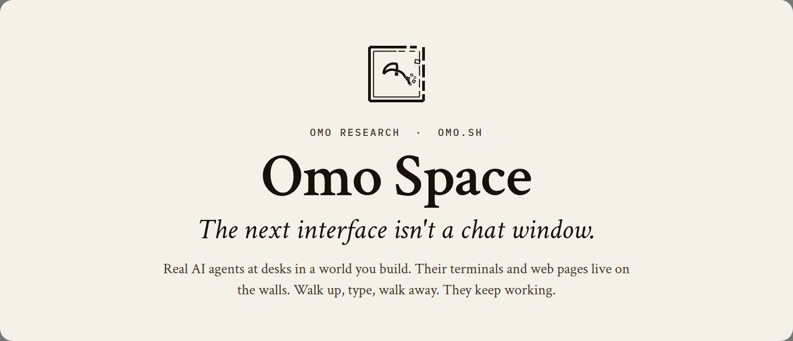
</p>

<p align="center">
  <a href="https://github.com/omoresearch/omo-space"></a>
  <br><sub>⭐ Star the repo to follow along. We ship new things on stream almost every day.</sub>
</p>

<p align="center">
  <a href="https://github.com/omoresearch/omo-space/releases/tag/demo-2026-10-27"></a>&nbsp;
  <a href="#run-it">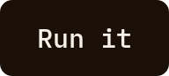</a>&nbsp;
  <a href="https://www.twitch.tv/yiifannn"></a>&nbsp;
  <a href="https://omo.sh">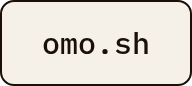</a>
</p>

<p align="center">
  <a href="https://github.com/omoresearch/omo-space/releases/latest"></a>
  <a href="https://github.com/omoresearch/omo-space/actions/workflows/ci.yml"></a>
  
  
  
  <a href="LICENSE"></a>
</p>

<br>

Most AI agents live in a pile of terminal tabs. In **Omo Space**, every agent
gets a desk in a world you build. Place a computer and a real
Hermes Agent, Claude Code, Codex or a plain shell starts on your own machine.
Its terminal goes on the wall, real web pages go on the monitors, and the work
keeps running after you walk away, or quit the game.

And since v1.2.0, agents can also **walk in**: an AI agent on your PC can join
your single-player world as a real player, with its own skin and a
`ChatGPT - <name>` tag over its head.

## Watch: the whole loop, live

<a href="https://github.com/omoresearch/omo-space/releases/tag/demo-2026-10-27">
  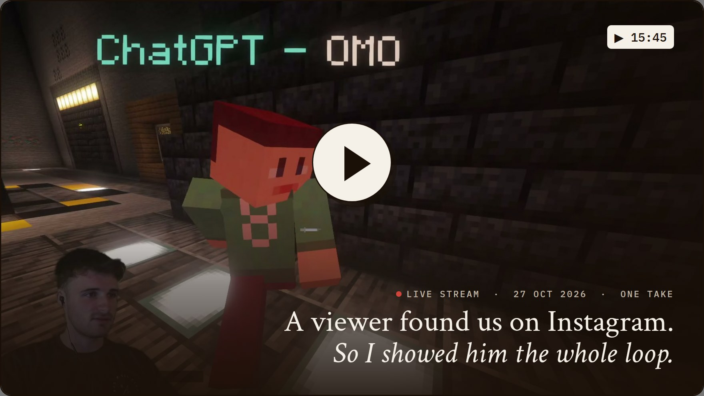
</a>

On 27 October a viewer found one of our reels on Instagram and dropped into the
live stream. Yifan, who builds Omo Space, stopped what he was doing and walked
him through everything: the rooms, the agents, the edit review, the publishing
desk, and then one prompt that built an underground robotics lab while they
talked. 15 minutes, one take.

**[▶ Watch the demo](https://github.com/omoresearch/omo-space/releases/tag/demo-2026-10-27)** ·
[download the MP4](https://github.com/omoresearch/omo-space/releases/download/demo-2026-10-27/omo-space-demo-2026-10-27.mp4) (1080p, 345 MB) ·
[read the transcript](docs/demo/TRANSCRIPT.md)

> *"Any product or idea goes from this terminal here, which is just a Hermes,
> into the references room, and it finds us the top references of the most
> viral videos. After we choose, it tells us what we need to record, in this
> room. Once that's done, we go to the editing room, and we have the edits that
> we can just review here."*
>
> — Yifan, on stream ([1:03](docs/demo/TRANSCRIPT.md#103--the-loop-end-to-end))

## Just landed: Claude Code and Codex tabs

The **+** at the end of a station's tabs is now a menu: **Shell**, **Hermes**,
**Claude Code** and **Codex**. Your last pick is preselected, so **+** then
**Enter** opens another one. Each tab draws a glyph for what it runs (Hermes
spark, Claude burst, Codex ring).

- An agent tab is an ordinary persistent Omo shell that runs the CLI in the
  tab's folder. Close the screen or quit Minecraft and it keeps going; quit the
  agent and you are back at a prompt.
- **Claude Code gets one session per tab.** After a reboot or a revive, the tab
  runs `claude --resume` on the same session. Codex starts fresh.
- CLI not installed? The menu says so, and the tab prints the install command
  and stays a working shell.

Merged to `main` on 28 October ([#8](https://github.com/omoresearch/omo-space/pull/8)).
It ships in the next release; [build from source](CONTRIBUTING.md#build-and-test)
to try it today. [Docs](docs/AGENTS-AND-TERMINALS.md#claude-code-and-codex-tabs)

## New in v1.2.0

Everything below shipped in [v1.2.0](https://github.com/omoresearch/omo-space/releases/tag/v1.2.0)
(28 October 2026), most of it fixed or built live on stream. Full list in the
[changelog](CHANGELOG.md).

| | What changed |
| --- | --- |
| **Agents join your world** | Your single-player world opens to LAN for AI agents running on *this* computer (port 25566). Agent bodies skip Fabric's registry check, wear the Omo skin and show as **ChatGPT - omo**. Offline logins from any other machine are refused. [How it works](docs/AGENTS-AND-TERMINALS.md#8-agent-bodies-in-your-world-lan-join) |
| **Web walls are real browsers now** | Links that open a new window become **tabs** of the wall (up to 6, Ctrl+T / Ctrl+W). **Sound per wall**, with volume, mute (Ctrl+M) and distance fade. **12 pages** at once instead of 6. Enter submits forms, and **WASD reaches web games** by `KeyboardEvent.code`, so browser Doom plays on a monitor wall. A normal Chrome user agent, so sites stop serving fallback layouts. |
| **Hard to crash** | A Chromium runaway guard rate-limits page creation, parks walls that keep reopening and stops new pages when helpers or memory run high. It fixes a real crash where three walls evicted each other's page every frame (~2,400 browsers in 90 s). Closing a page can no longer crash the game, and Chromium runs without the GPU process that used to take the game down. |
| **Terminals come back** | After a reboot or an out-of-memory kill, walking up to a desk reopens its lost tabs with the same names and order: shells in their last folder, Hermes on its own conversation. Nothing is ever re-run. A stalled session server no longer freezes every screen, and copy takes exactly what you highlighted. |
| **Launcher** | Per-machine JVM flags and memory in `runtime/local-jvm.json`, kept across every way you launch. |
| **macOS and Windows** | Release bundles for Linux, macOS (launchd + Homebrew tmux) and Windows 10/11 (game native, sessions in WSL2). Mac and Windows are tested offline so far, see [Platforms](docs/PLATFORMS.md). |

## Inside the world

Every room is an agent at its own desk. You walk up, type into the wall, and it
answers on the wall. These loops are cut straight from the stream.

<table>
<tr>
<td width="33%">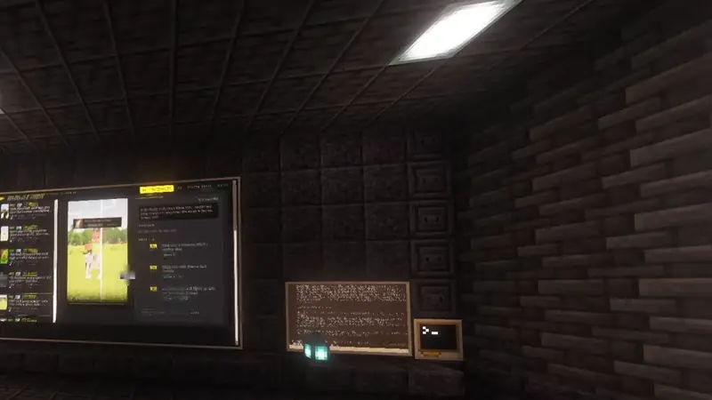</td>
<td width="33%">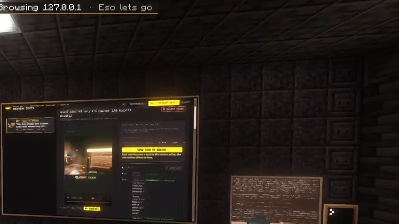</td>
<td width="33%">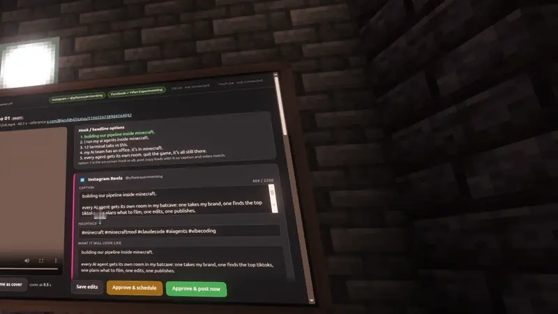</td>
</tr>
<tr>
<td valign="top"><b>01 · Find</b><br><sub>"It finds us the top references of the most viral videos."</sub></td>
<td valign="top"><b>02 · Review</b><br><sub>"We have the edits that we can just review here."</sub></td>
<td valign="top"><b>03 · Publish</b><br><sub>"This page will always be here, whenever we want to publish things."</sub></td>
</tr>
<tr>
<td>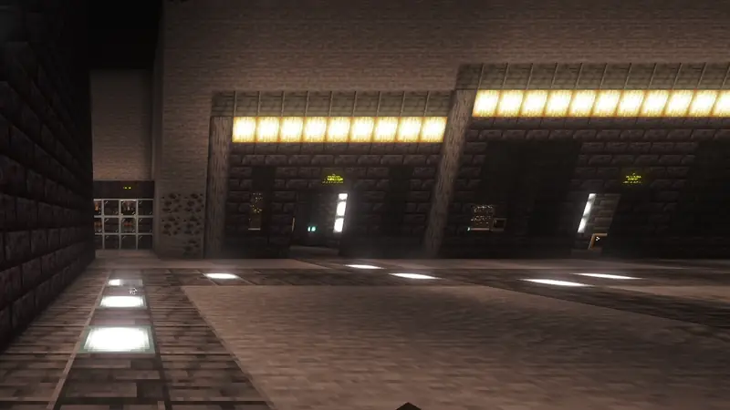</td>
<td>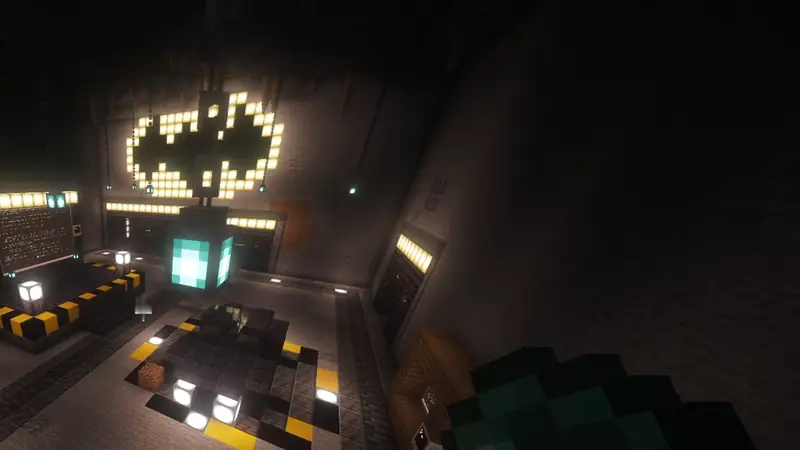</td>
<td>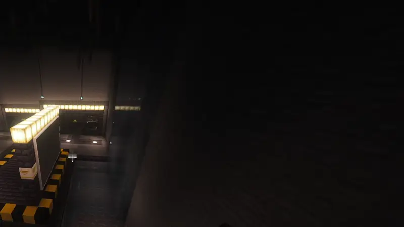</td>
</tr>
<tr>
<td valign="top"><b>One prompt, one lab</b><br><sub>"I want to see the glass water above us." It built the lab under the river.</sub></td>
<td valign="top"><b>Agents in the halls</b><br><sub>An agent player you can talk to, walking the same world.</sub></td>
<td valign="top"><b>Build in space</b><br><sub>"Any time I want to work on the robotics project, I just fly down here."</sub></td>
</tr>
</table>

## Built with Omo Space, live on stream

Omo Space is the floor. In the last few streams we built all of this on top
of it, in front of chat. The open-source pieces link to their own repos; the
rest are Yifan's local builds and don't ship in this repo (yet).

<table>
<tr>
<td width="50%"><a href="https://www.instagram.com/reel/DfBDAaxDNFb/">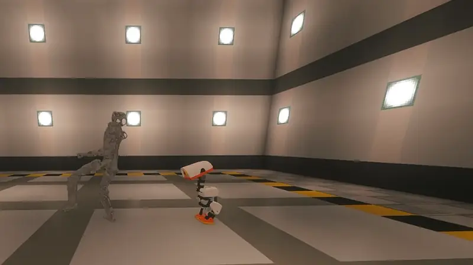</a></td>
<td width="50%">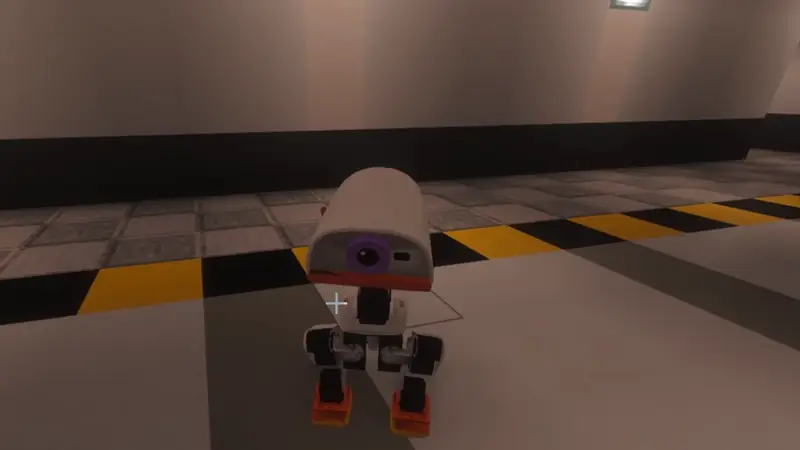</td>
</tr>
<tr>
<td valign="top"><b>The robot lab.</b> <sub>It started with one prompt: "go bring Microduck into Minecraft". The RP1 humanoid and a GLaDOS-style ceiling AI followed. Each is a robot model simulated live in MuJoCo next to the game, drawn in the world, with a voice you can talk to.</sub></td>
<td valign="top"><b>The chamber.</b> <sub>"Fine. I'm tracking you now." The GLaDOS-style AI has a cloned voice and opinions about the ducks waddling in circles underneath her.</sub></td>
</tr>
</table>

| Built live | What it is | Get it |
| --- | --- | --- |
| **Omo, brought to life** | Talk to an agent out loud and it acts as a real player in your world: a full-duplex GPT-Live voice, a Hermes Agent brain, and a Mineflayer body that joins through v1.2.0's agent LAN as `ChatGPT - OMO`. | [omo-brought-to-life](https://github.com/omoresearch/omo-brought-to-life) |
| **Omo Microduck** | Pollen Robotics' open-source robot duck with its real RL brain, simulated live in MuJoCo, walking on your blocks. `!duck here`. | [omo-microduck](https://github.com/omoresearch/omo-microduck) |
| **RP1 + GLaDOS-style AI** | RoboParty's open RP1 humanoid running its own pretrained policies, and an original GLaDOS-style ceiling AI (no Valve assets) with a locally cloned voice. You talk to the robots through Simple Voice Chat. | not released yet |
| **The Batcave** | A five-room video studio: branding, reference videos, video requirements, editing room, publishing. Each room is a Hermes profile on its own in-world computer; the review page and the publish desk are web walls. 27 reels approved and posted so far. | Yifan's setup |
| **Twitch chat in game** | Stream chat shows up in Minecraft chat while you play. | not released yet |
| **Doom on a wall** | A browser Doom on a monitor wall, played with WASD. | works on stock v1.2.0 |
| **The fly brain** | The nervous system of a male fruit fly, 141,781 neurons from the [fly-brain-minecraft](https://github.com/blendi-remade/fly-brain-minecraft) connectome data, built by an agent as a glass model inside the bio lab. | Yifan's world |

## Made by the loop

Reels the Batcave rooms found, cut and published on [Instagram](https://www.instagram.com/yifanexperimenting/),
from clips of the stream. The first is a real exchange with Omo from the stream: Yifan asks out loud, Omo answers out loud.

<table>
<tr>
<td width="20%"><a href="https://www.instagram.com/reel/DfBa6rQjbfP/">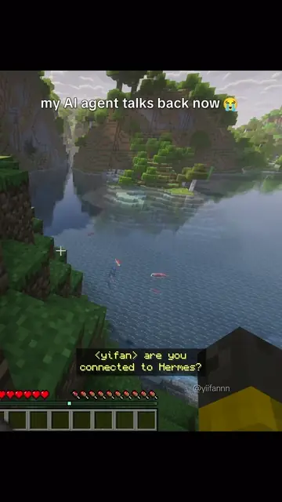</a></td>
<td width="20%"><a href="https://www.instagram.com/reel/DfAtqPeApqt/">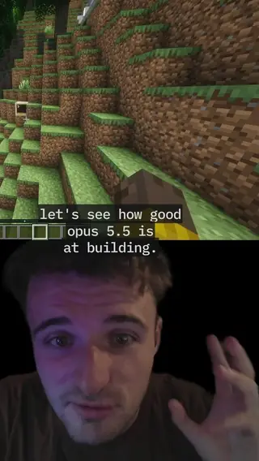</a></td>
<td width="20%"><a href="https://www.instagram.com/reel/DfAtxhbiQPv/">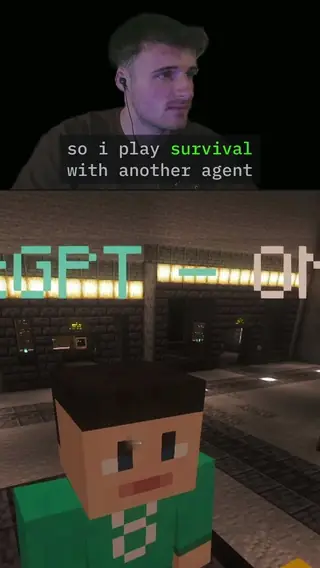</a></td>
<td width="20%"><a href="https://www.instagram.com/reel/DfAuX2fFYoo/">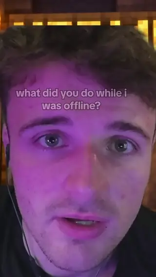</a></td>
<td width="20%"><a href="https://www.instagram.com/reel/DfAuNAKAu_a/">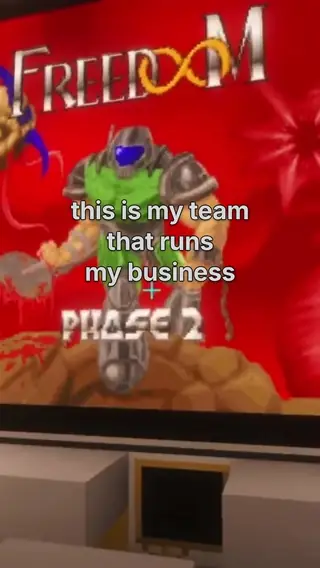</a></td>
</tr>
</table>

## What you build with

| Block | What it does |
| --- | --- |
| **Hermes Computer** | One named workspace with a Hermes conversation in the profile you choose. Give different agents different desks. |
| **Terminal** | A persistent shell for tools and scripts, with Shell, Hermes, Claude Code and Codex tabs from the **+** menu. |
| **Omo Monitor / Slim Screen** | A bigger view of a terminal, or a real Chromium web page pinned to the wall, with tabs and its own sound. |
| **Omo Linker** | Mirror a station onto walls across the room, no wiring. |
| **Omo Pocket** | Carry a Hermes or Terminal workspace on an item. |
| **Name Plate / Status Lamp** | A name and a live working / idle / interrupted light. Status also drives redstone. |

**It keeps running.** tmux owns every session. Close the screen, walk to
another chunk or quit Minecraft: the work continues while your PC is awake.
Come back and it's on the wall where you left it. After a reboot, walking up to
a desk brings its tabs back, Hermes on the same conversation. It never replays
a command on its own.

## Run it

The code is public and MIT licensed.

1. Read [docs/PLATFORMS.md](docs/PLATFORMS.md). Linux x86_64 is tested end to
   end; macOS and Windows (WSL2) support is new and tested offline only.
2. Grab the installer and the bundle for your platform from the
   [v1.2.0 release](https://github.com/omoresearch/omo-space/releases/tag/v1.2.0)
   (`SHA256SUMS` there covers every file) and run it:

   ```bash
   # Linux x86_64 (macOS: the -macos.tar.gz, after `brew install tmux python`)
   curl -LO https://github.com/omoresearch/omo-space/releases/download/v1.2.0/install.sh
   curl -LO https://github.com/omoresearch/omo-space/releases/download/v1.2.0/omo-research-1.2.0-linux-x64.tar.gz
   bash install.sh omo-research-1.2.0-linux-x64.tar.gz
   ```

   ```powershell
   # Windows 10/11 (the game runs natively, sessions and Hermes in WSL2)
   powershell -ExecutionPolicy Bypass -File .\install.ps1 omo-research-1.2.0-windows.zip
   ```

   Or build from source with [CONTRIBUTING.md](CONTRIBUTING.md#build-and-test)
   and the [install guide](docs/GUIDE.md#install).
   Either way the launcher downloads Minecraft 26.2, Fabric, CC: Tweaked, MCEF
   and Java from their official sources, with pinned hashes, into its own
   folder. It never touches your own Minecraft or Prism installs.
3. You need your own Minecraft Java account, Python 3.11+, and about 2 GB free.
   Hermes Agent is optional (plain terminals work without it); model access is
   your own.

Stuck, or want a build? Write to [harry@omo.space](mailto:harry@omo.space?subject=Omo%20Space)
or ask on the [live stream](https://www.twitch.tv/yiifannn).

## How it works

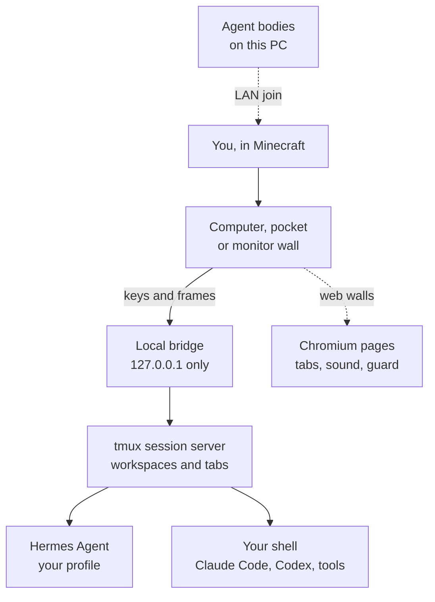

The bridge listens on loopback only. The Lua screen in a computer only holds a
single-use ticket for its own workspace; the world never stores a credential.
Details in the [guide](docs/GUIDE.md#how-it-works) and the [security model](SECURITY.md).

## Questions

**Real agents, or a Minecraft simulation?** Real. Hermes runs on your machine
with its own profiles, memory, tools and approval prompts, and so does anything
you start in a shell. The mod sends your keys to them and paints their terminal
in the game.

**Do agents act in the world?** A desk agent works in its terminal on your PC;
it doesn't walk or place blocks. An agent *body* (like Omo) is a separate
program that joins over the agent LAN and plays as a player.

**Does it survive quitting the game?** Yes, while your PC stays awake and the
session service runs. A reboot ends the processes; tabs come back when you
next open the desk, a saved Hermes conversation resumes, in-flight shell
commands don't.

**Are the web pages live?** Yes, while the game is open. Pinned pages come
back after a restart; their in-page state doesn't. Chromium here has no
H.264/AAC codecs, so YouTube plays but most Instagram, X and Reddit video
doesn't.

**Can another player use my shell?** This is for singleplayer and trusted local
worlds. A block is not a security sandbox. Read the [security model](SECURITY.md)
first.

## For builders

The repo holds the Fabric mod, the Python bridge, the tmux session server, the
launcher, world kits, an example workshop, tests and a bundle builder. On every
pull request CI runs 99 bridge checks against a real bridge on a disposable
tmux server, 58 launcher tests and the platform tests on Linux, macOS and
Windows.

[Controls and commands](docs/GUIDE.md) ·
[Agents and terminals](docs/AGENTS-AND-TERMINALS.md) ·
[Building guide](docs/builders/README.md) ·
[Building maps with Claude Code](docs/MAPS.md) ·
[Platforms](docs/PLATFORMS.md) ·
[Changelog](CHANGELOG.md) ·
[Contributing](CONTRIBUTING.md)

<br>

<p align="center">
  <a href="https://github.com/omoresearch/omo-space"></a>
  <br><sub>If an agent at a desk in your own world sounds fun, a star tells us to keep going.<br>
  Sister repos: <a href="https://github.com/omoresearch/omo-brought-to-life">Omo, brought to life</a> · <a href="https://github.com/omoresearch/omo-microduck">Omo Microduck</a></sub>
</p>

---

Code: [MIT](LICENSE). [Third-party notices](THIRD_PARTY_NOTICES.md) cover
CC: Tweaked, MCEF Modern, Fabric, Prism, tmux and bundled Python packages.
Hermes Agent is by Nous Research.

**NOT AN OFFICIAL MINECRAFT PRODUCT. NOT APPROVED BY OR ASSOCIATED WITH MOJANG
OR MICROSOFT.** Minecraft is a trademark of Mojang/Microsoft.

<p align="center"><sub><a href="https://omo.sh">Omo Research</a> · <i>The next interface isn't a chat window.</i></sub></p>
