

  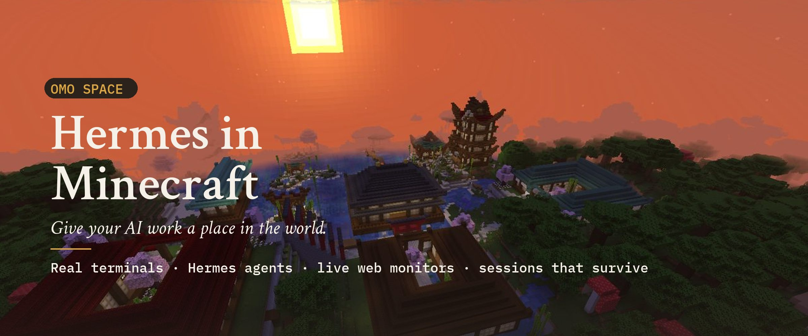

<h1 align="center">Your AI workspace, built in Minecraft.</h1>

  Place a computer. Start a real Hermes Agent session. Put its terminal on a wall. 
  Walk away and come back to the same work, even after closing the game.

  <a href="mailto:harry@omo.space?subject=Omo%20Space%20Minecraft%20preview"><b>Request private preview</b></a>
  &nbsp;·&nbsp;
  <a href="#see-it-in-action">See it in action</a>
  &nbsp;·&nbsp;
  <a href="#for-builders">Technical details</a>

Private preview · Linux x86_64 · macOS · Windows (WSL2) · Minecraft Java 26.2 · Your own Minecraft account required

---

## A place for work that keeps running

Most agent interfaces disappear when you close the window. Here, the workspace
has a place in the world. Build a desk for an agent, give it a monitor wall, and
walk over when you want to see or control its work. The computer connects to a
real shell on your machine; the Hermes tab connects to a real Hermes session in
the profile you choose.

The game is the interface. Your computer still does the work.

## See it in action

<table>
<tr>
<td width="50%">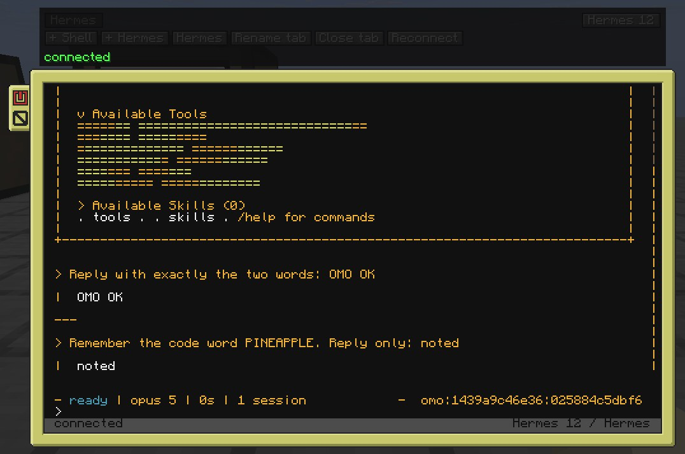</td>
<td width="50%">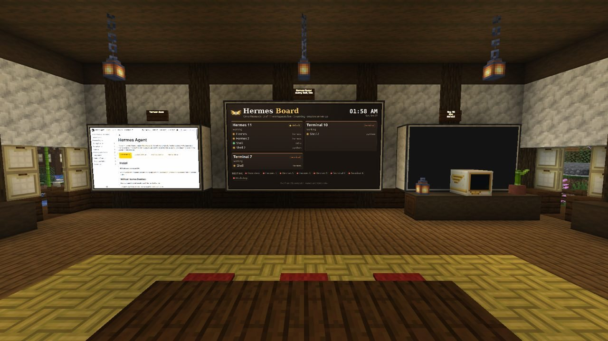</td>
</tr>
<tr>
<td align="center"><b>Talk to Hermes.</b> Tabs, a profile, a live terminal and the conversation you return to.</td>
<td align="center"><b>See the room work.</b> A live workspace board and real web pages on monitor walls.</td>
</tr>
</table>

The world is yours to build. These two island images are from our current
Minecraft play world, captured on 30 September 2026. They are separate from
the product close-ups above, not a staged composite.

<table>
<tr>
<td width="50%">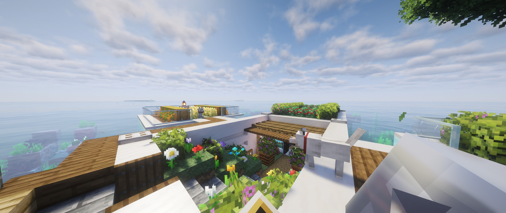</td>
<td width="50%">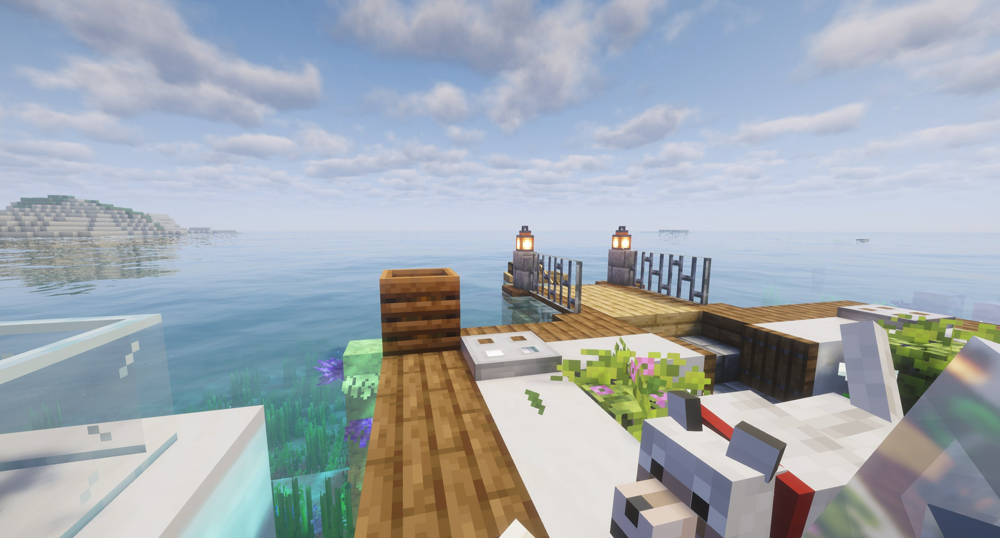</td>
</tr>
<tr>
<td align="center">The island rooftop. The workspace can be part of any build you make.</td>
<td align="center">Across the water, away from the screen. Your sessions keep running on the host.</td>
</tr>
</table>

The island captures use Complementary Unbound shaders for lighting. The
shader pack is not included in Omo Space.

### The loop

1. **Place** a Hermes Computer or Terminal from the Omo Space inventory tab.
2. **Open** it. Start Hermes, work in a shell, or switch tabs. Connect monitor
   walls to show the same terminal elsewhere in the room.
3. **Leave.** Close the screen, walk to another chunk or quit Minecraft. The
   session continues while your host is awake and the session service runs.
4. **Return** to the same workspace. If the host rebooted, Omo shows that the
   process was interrupted and offers an explicit resume of the saved Hermes
   conversation. It never silently replays a command.

## Make a room worth coming back to

| Build with | What it does |
| --- | --- |
| **Hermes Computer** | One named workspace, with a Hermes conversation in its chosen profile. Give different agents different desks. |
| **Terminal** | A persistent shell when you want tools without starting an agent. |
| **Omo Monitor / Slim Screen** | A larger view of a terminal, or a pinned Chromium webpage. A wall can show docs, a dashboard or your project preview. |
| **Omo Linker** | Connect a wall to a station across the room, without wiring. Multiple walls can mirror one station. |
| **Omo Pocket** | Carry a Hermes or Terminal workspace on an item. |
| **Name Plate / Status Lamp** | Put a name and live working, idle or interrupted state on the build. Status also works with redstone. |

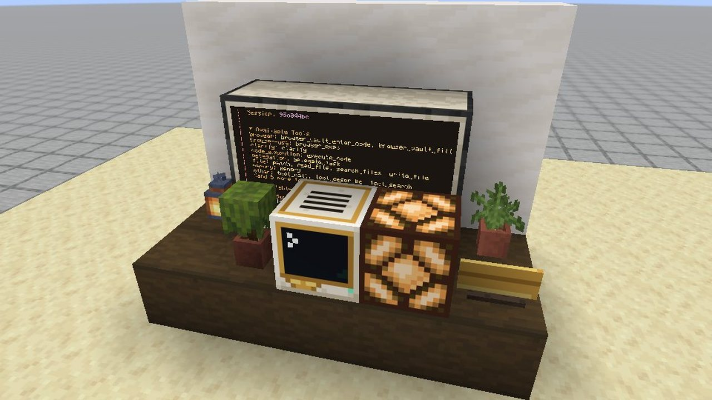

<b>More real in-game images</b> — web gallery, terminal tabs and room kit

 
<table>
<tr>
<td width="50%">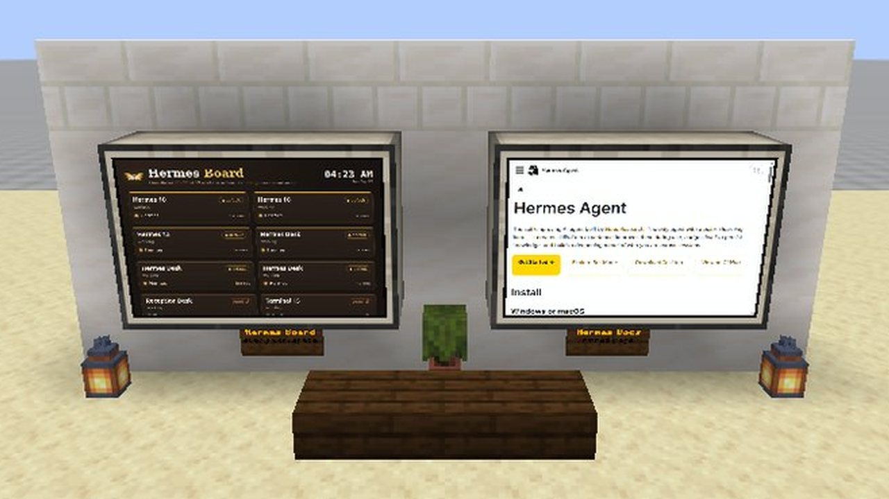</td>
<td width="50%">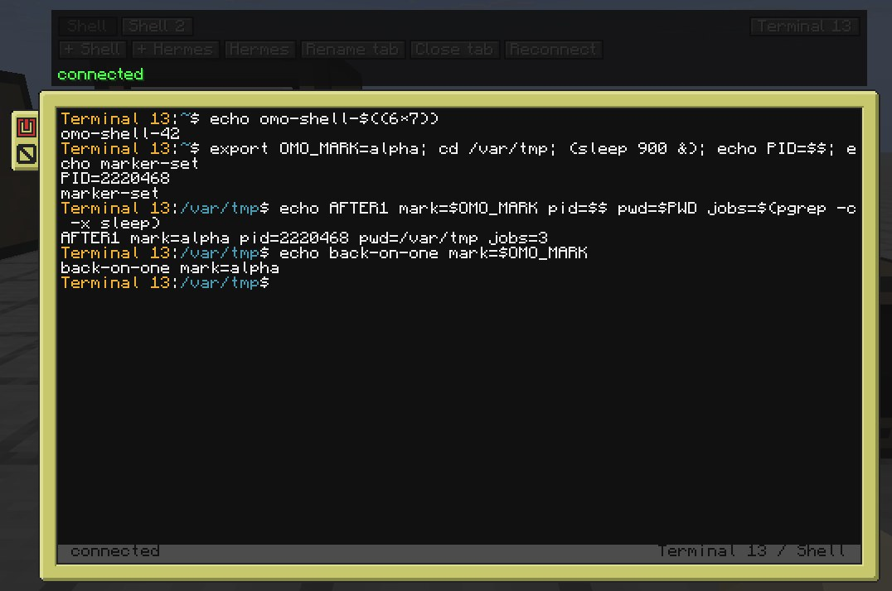</td>
</tr>
<tr>
<td align="center">Real webpages on monitor walls.</td>
<td align="center">Two tabs, with the same PID, directory and environment on return.</td>
</tr>
<tr>
<td>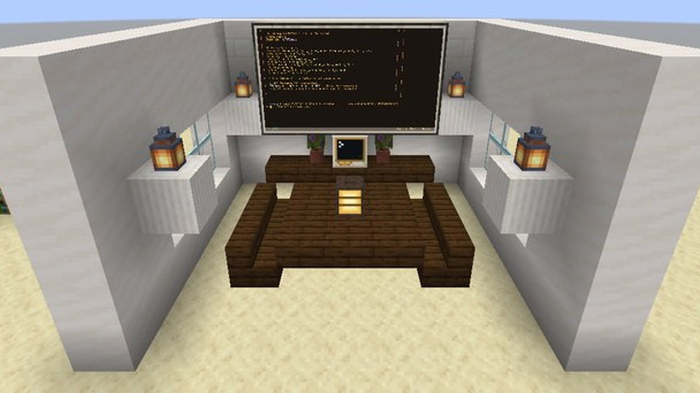</td>
<td>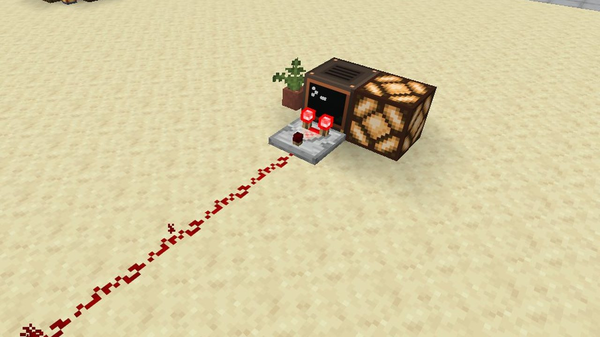</td>
</tr>
<tr>
<td align="center">A big screen for a shared room.</td>
<td align="center">Build a redstone signal from the agent's state.</td>
</tr>
</table>

## Who this is for

Developers and researchers who want to *see* their tools in the world they
build. Use a computer for a real Hermes conversation, a plain terminal for
shell work, and a web wall for the docs or dashboard you keep checking. It is
local-first: the bridge runs on your PC, not on a public shell server.

This is an early preview, not a promise of a hosted multiplayer service.
The world, the host shell and the agent are yours to control.

## Get access

**The repo and build are private for now.** There is no public download,
checkout or published GitHub Release yet. [Request a private
preview](mailto:harry@omo.space?subject=Omo%20Space%20Minecraft%20preview)
if you want to test it. We have not announced pricing or a public release.

A preview requires Linux x86_64 with systemd, macOS with Homebrew tmux, or
Windows 10/11 with WSL2 (see [docs/PLATFORMS.md](docs/PLATFORMS.md)); Python
3.11+; a Minecraft Java account and enough space for the game runtime (about 2 GB free). Hermes Agent is
optional for plain terminals. Minecraft and third-party mods are downloaded by
the launcher with pinned hashes. Model-provider access, if you use Hermes, is
separate from Minecraft.

The Linux bundle builds locally and passed install/uninstall in a throwaway
home directory. A clean-machine play-through past Microsoft sign-in remains to
be done before a public release. macOS and Windows support is new and has been
tested offline only, not yet on real Mac or Windows hardware.

## A few important answers

**Is this a real agent or a Minecraft simulation?** A real Hermes process runs
on your machine. The mod sends input to it and paints its terminal in the game.
Hermes uses its own profiles, memory, tools and approval prompts.

**Does the session survive when I quit Minecraft?** Yes, while the host stays
awake and the tmux session server runs. A reboot ends the process. The saved
Hermes conversation can be resumed explicitly; in-flight shell commands cannot.

**Are webpages live?** Yes, while Minecraft is open. The assigned page returns
after a game restart; the browser's in-page state does not.

**Can another player use my host shell?** This preview is for singleplayer or
trusted local worlds. A world or a block is not a security sandbox. Read the
[security model](SECURITY.md) before connecting an untrusted world.

## For builders

The repo includes the Fabric mod, Python bridge, tmux session server, launcher,
world kits, an example workshop, tests and a Linux bundle builder. See the
[full controls and command guide](docs/GUIDE.md), [building guide](docs/builders/README.md),
[agents and terminals](docs/AGENTS-AND-TERMINALS.md), [building maps with Claude Code](docs/MAPS.md),
[release checklist](docs/RELEASE-CHECKLIST.md) and [contribution guide](CONTRIBUTING.md).

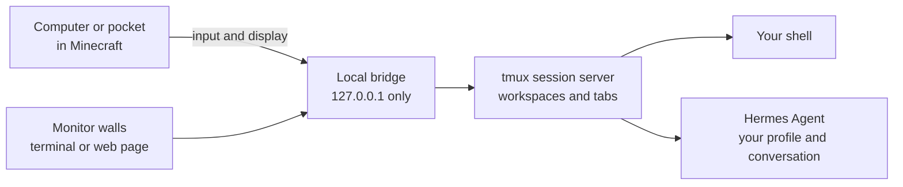

Local verification: **61/61 bridge** and **56/56 launcher** tests passed. The
mod jar built, and the private Linux bundle passed checksum and isolated
install/uninstall checks. [In-game checks](docs/RELEASE-CHECKLIST.md) were last
recorded on this Linux host; GitHub Actions has not run because the account's
billing/spending limit blocked the runner before it started. The preview is not
yet a public release.

Omo Space's code is [MIT licensed](LICENSE). [Third-party
notices](THIRD_PARTY_NOTICES.md) cover CC: Tweaked, MCEF Modern, Fabric, Prism,
tmux and bundled Python packages. Hermes Agent is by Nous Research.

**NOT AN OFFICIAL MINECRAFT PRODUCT. NOT APPROVED BY OR ASSOCIATED WITH
MOJANG OR MICROSOFT.** Minecraft is a trademark of Mojang/Microsoft.

Omo Space · Give your AI work a place in the world.

