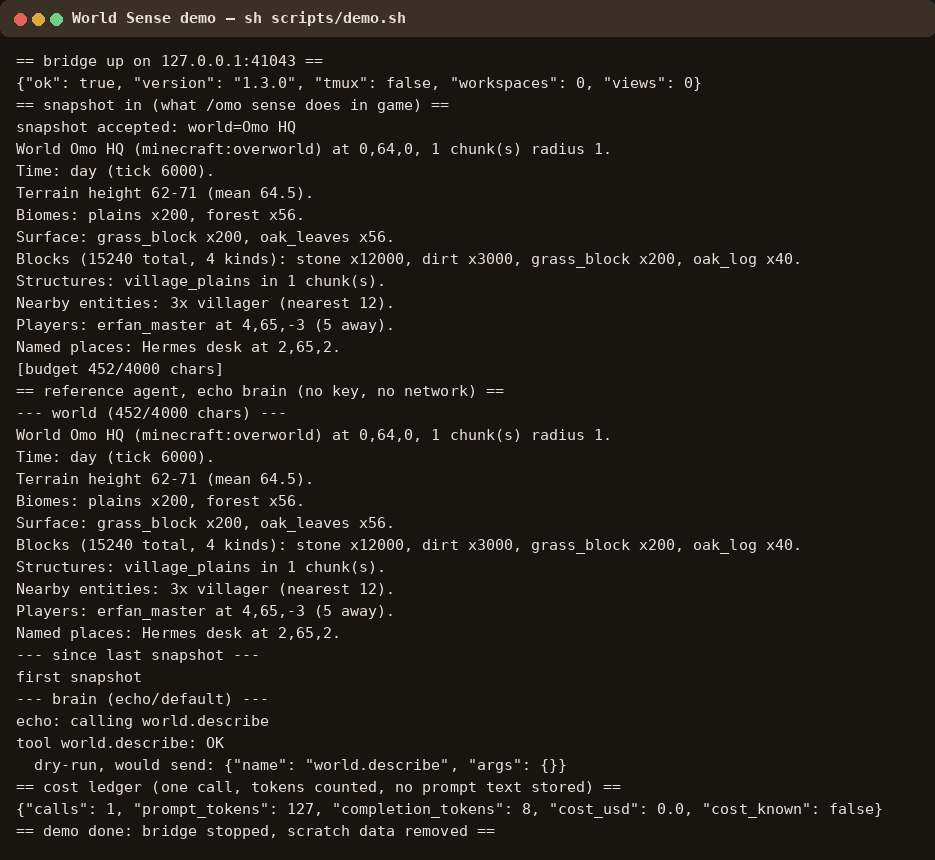
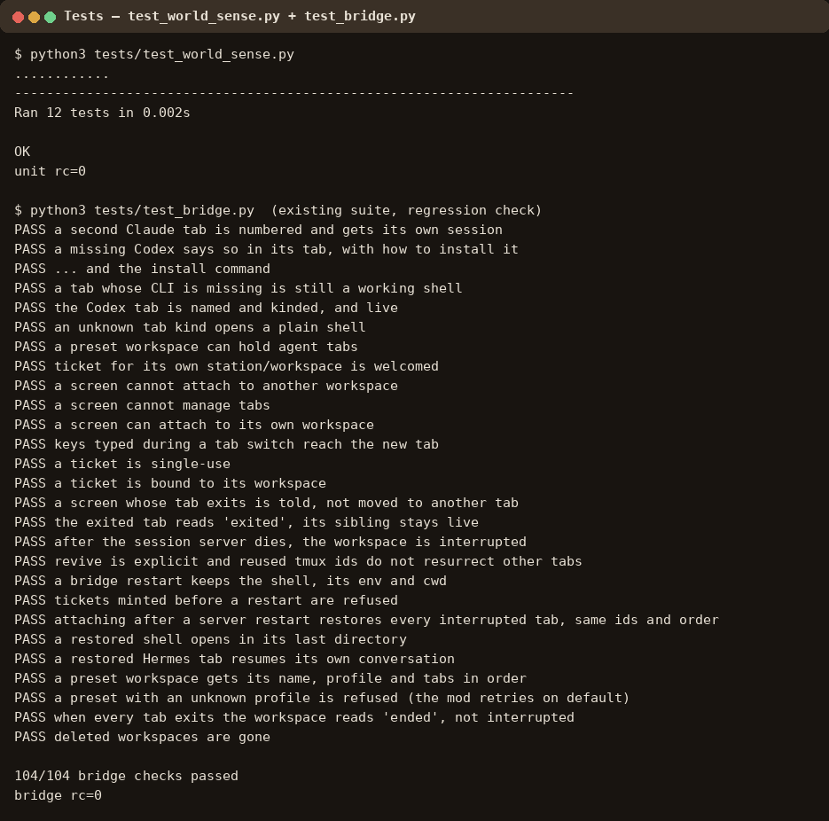

# Try World Sense in 5 minutes

No game, no key, no model needed for the read path. Everything below was
run for real; the screenshots are terminal captures of those exact runs
(the loopback port in them will differ on your machine — it is picked
fresh every run).

## 0. Get the code

Either check out this branch (`feat/world-sense-byo-brain`), or grab the
testable release:

```sh
# from the release tarball (see dist/omo-world-sense-0.1.0.tar.gz + SHA256SUMS):
sha256sum -c SHA256SUMS
tar xzf omo-world-sense-0.1.0.tar.gz
cd omo-world-sense-0.1.0
```

Requires Python 3.11+. Nothing to install: the bridge vendors its own
dependencies, and the demo uses only the standard library.

## 1. The one-command demo

```sh
sh scripts/demo.sh
```

It starts a scratch bridge on a free loopback port, pushes the canned
snapshot (`examples/demo_snapshot.json` — the same one the tests use),
runs the reference agent with the deterministic echo brain, and prints
the cost ledger. Expected output (screenshot below): a ~450-char world
summary, one validated tool call (`world.describe`), one ledger entry.



What you are looking at:

- `snapshot accepted: world=Omo HQ` — the bridge took a snapshot exactly
  the way `/omo sense` sends one from the game.
- The summary text: terrain height 62–71, biomes, surface and block
  histograms, a village structure, 3 villagers, one player. No raw
  blocks anywhere — a chunk is 16×16×~384 blocks; this is histograms.
- `echo: calling world.describe` — the brain chose a tool from the fixed
  list, and the bridge validated it before anything was sent.
- `{"calls": 1, "prompt_tokens": 127, ...}` — the cost ledger counted the
  call. No prompt text is stored in it, ever.

## 2. The tests

```sh
python3 tests/test_world_sense.py   # 12 checks, no game / network / key
python3 tests/test_bridge.py        # the existing 104-check bridge suite
```



## 3. Poking the bridge yourself

Run the demo's pieces by hand against your own bridge (the one Omo
installed, on `:8780` — token from `~/.local/share/omo/token`):

```sh
# what tools exist, and their hard limits:
curl "http://127.0.0.1:8780/world/tools?token=$(cat ~/.local/share/omo/token)"

# which brains could run here (echo always; the rest need their CLI / key):
curl "http://127.0.0.1:8780/world/brain?token=$(cat ~/.local/share/omo/token)"

# the latest world description (empty until a snapshot arrives):
curl "http://127.0.0.1:8780/world/describe?token=$(cat ~/.local/share/omo/token)"

# the spend so far:
curl "http://127.0.0.1:8780/world/cost?token=$(cat ~/.local/share/omo/token)"
```

Without a token every `/world/*` route answers `forbidden` — try it, that
is the check.

## 4. With a real brain

```sh
export OPENROUTER_API_KEY=...   # or install the Muse / Claude CLI
python3 tools/world_agent.py --bridge http://127.0.0.1:8780 \
  --token-file ~/.local/share/omo/token \
  --backend openrouter --model anthropic/claude-haiku-4.5 \
  --task "describe the area and call world.describe"
```

The point of the design: Haiku (or any small model) gets the same short
summary the echo brain got. It does not need to be the biggest model,
because the game already did the seeing.

## 5. In game (Fabric 26.2, this branch)

```sh
# build the mod the usual way (Fabric Loom; CI does this too):
#   cd mod && ./build.sh
# then in game, stand where you want described:
/omo sense        # one chunk; /omo sense 1 for 3x3
/omo describe     # same, plus a summary in chat
```

Then read it from outside the game exactly as in step 3. Writes
(`world.set` and friends) stay off unless the game was started with
`-Domo.world.tools=true` — that flag is the review gate, on purpose.

## What is NOT in this release (on purpose)

- No built mod jar. The jar needs Fabric Loom + game jars, which CI
  builds; shipping a jar I built on one machine would be the wrong
  artifact to trust. The release has the mod sources instead.
- No Minecraft GUI screenshots. There is no game running in this test
  path, so the screenshots are terminal captures of real runs — labelled
  as such, not mockups. In-game shots of `/omo sense` output are welcome
  as a follow-up once someone runs the mod.
- No hosted server. The panel / flat-fee / OpenRouter proposal lives in
  `docs/WORLD-SENSE.md` §5 — it is a question for Yifan, not a claim.
