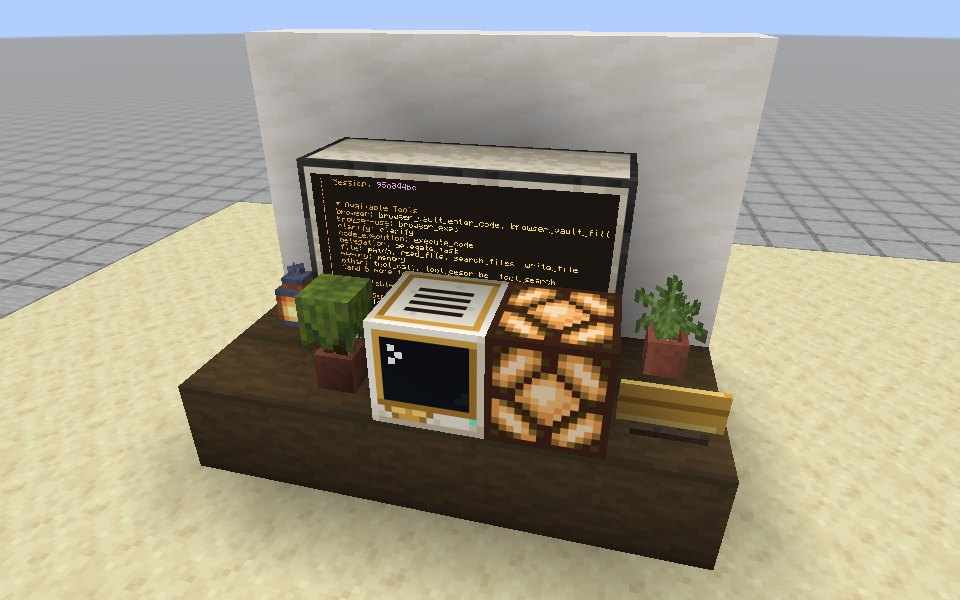
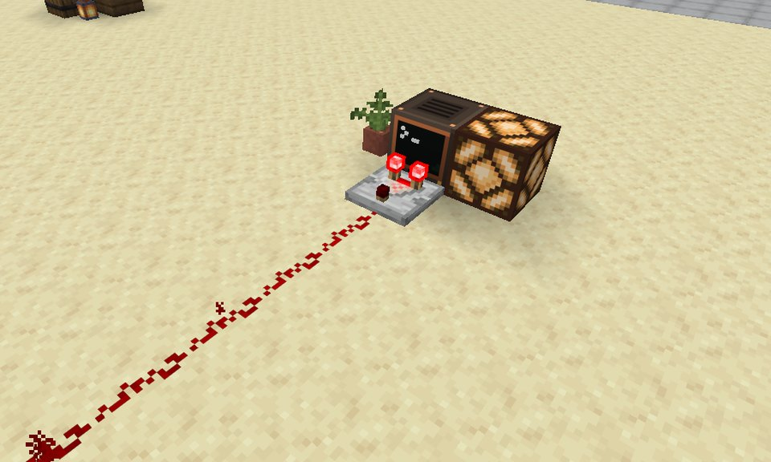
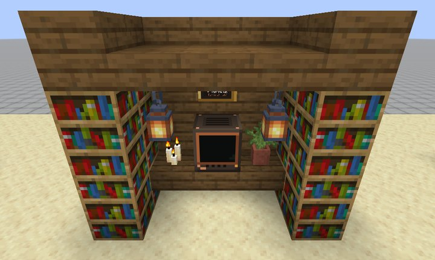
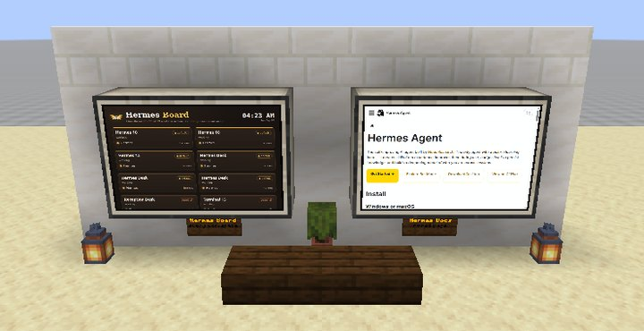
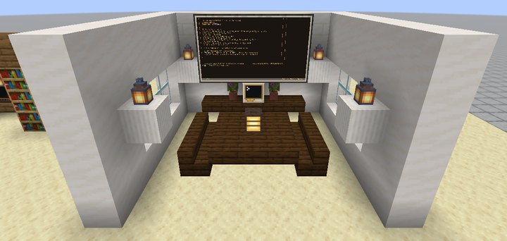
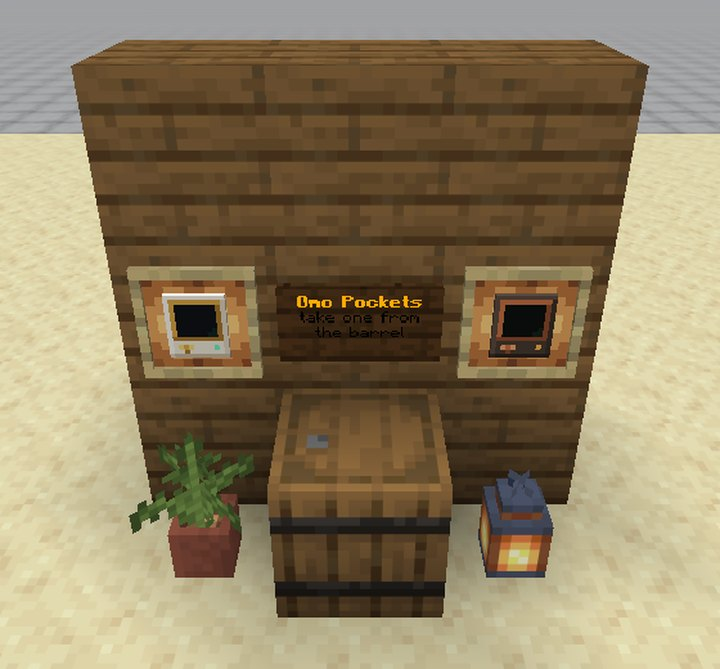
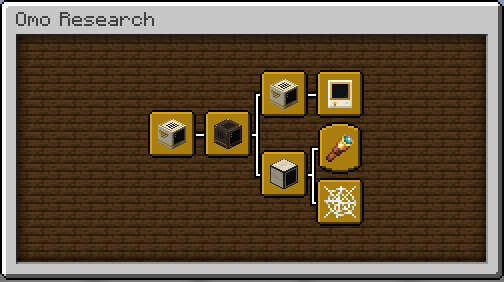
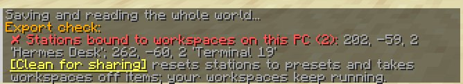

# Building with Omo Space

**Real computers for your Minecraft builds.** A Hermes Computer in Omo
Research is not a prop: its screen is a real shell on your PC, and its first
tab is a real Hermes agent. This guide is for builders, in creative and in
survival, and for map makers who want to share what they built.



*The **Hermes Desk** room kit. Hermes is working on a reply, so the redstone
lamp next to the computer is lit. When Hermes finishes, the lamp goes dark.*

---

**Contents**

1. [Your first desk in five minutes](#1-your-first-desk-in-five-minutes)
2. [The blocks](#2-the-blocks)
3. [Recipes (survival)](#3-recipes-survival)
4. [Screens and walls](#4-screens-and-walls)
5. [Presets: what a station becomes](#5-presets-what-a-station-becomes)
6. [Redstone](#6-redstone)
7. [Room kits](#7-room-kits)
8. [Advancements](#8-advancements)
9. [Sharing a map safely](#9-sharing-a-map-safely)
10. [For power users: Lua and the `omo` API](#10-for-power-users-lua-and-the-omo-api)
11. [Command reference](#11-command-reference)
12. [Troubleshooting](#12-troubleshooting)

---

## 1. Your first desk in five minutes

**In creative:**

1. Open the creative inventory and choose the **Omo Space** tab.
2. Place a **Hermes Computer**. It turns to face you, like a furnace.
3. Build a wall of **Omo Monitors** that touches the computer: 3 wide and 2
   high is a good start. The monitors join into one screen as you place them.
4. Right-click the computer. Its workspace is created on your PC and Hermes
   says hello. The wall shows the same screen, at a text size that fits.
5. Put a **redstone lamp** against the computer and run `/omo signal on`
   while you look at it. From now on the lamp lights whenever Hermes works.

Too many steps? Look at the floor and type `/omo kit hermes_desk`. The
whole desk from the picture above appears there, facing you.

**In survival:** craft a CC: Tweaked *advanced computer* first. Once you
hold one, the recipe book (the green book in your inventory) shows the Omo
recipes. See [Recipes](#3-recipes-survival).

> [!NOTE]
> Stations reach your PC, so in a multiplayer world only the world owner and
> operators can open them and use `/omo`. Anyone can look at the screens.

## 2. The blocks

| Block | What it is for |
| --- | --- |
| **Hermes Computer** (cream and gold) | A workspace whose first tab is a Hermes conversation. One desk per agent: each can run its own Hermes profile. |
| **Terminal** (espresso and copper) | A persistent shell. Nothing starts an agent unless you do. |
| **Omo Monitor** | A screen block. Walls of any size join like CC: Tweaked monitors. A wall shows a station's terminal, or a pinned web page. |
| **Slim Screen** | The same screen as a 3-pixel panel that mounts on the face you click: walls, floors, ceilings. Right-click the wall with a dye or bone meal to change the frame colour. |
| **Omo Pocket** (Hermes or Terminal) | A station in your hand. Right-click to open. Its workspace is made on first use and stays with the item. |
| **Omo Linker** | A wand that connects screens to a station without touching it (see [Linking](#linking-screens-from-afar)). |
| **Name Plate** | A small plaque with the nearest station's workspace name and a state dot. |
| **Status Lamp** | A paper lantern that glows gold while the nearest station works, green when idle and red when interrupted. |

Everything behaves like a vanilla block: it rotates to face you, drops
itself when broken, and works with pick-block. **A station keeps its
workspace when you pick it up.** Break it, carry it across the map, place it
again, and the same shell is waiting.

## 3. Recipes (survival)

Every recipe is in the recipe book. It unlocks when you pick up the key
ingredient: an advanced computer, an advanced pocket computer, or an Omo
station.

| Result | Recipe (top row first) |
| --- | --- |
| Hermes Computer | `_ F _` / `G C G`. F = feather, G = gold ingot, C = advanced computer |
| Terminal | `_ c _` / `c C c`. c = copper ingot, C = advanced computer |
| 4 Omo Monitors | `G B G` / `G P G` / `G G G`. G = gold ingot, B = bone meal, P = glass pane |
| 3 Slim Screens | `G B G` / `G P G`. The same ingredients, one row fewer |
| Omo Pocket (Hermes) | `_ F _` / `G P G`. P = advanced pocket computer |
| Omo Pocket (Terminal) | `_ c _` / `c P c` |
| Omo Linker | Ender pearl, gold ingot and stick, laid corner to corner like a tool |
| 2 Name Plates | `N N N` / `D R D`. N = gold nugget, D = dark oak planks, R = redstone |
| Status Lamp | `S P S` / `P G P` / `S R S`. S = stick, P = paper, G = glowstone, R = redstone |

## 4. Screens and walls

**A wall touching a station is that station's second screen.** Put monitors
against any side of a Hermes Computer or Terminal. The wall shows the same
tab at its own size, with the largest text that fits. It does not need to
match the computer's screen size.

- **Any size works.** A 3x2 wall is a comfortable second screen, and 8x4
  makes a cinema. A wall too small for readable text shows a status card.
- **Control a wall from where you stand.** Right-click the wall (up to 24
  blocks away). Your keys go to its station and the crosshair becomes the
  mouse. W, A, S and D type letters instead of walking. **Esc** lets go.
- **Web walls.** Shift+right-click a wall with an empty hand, then choose
  **Web page**, type an address and click **Pin page**. The page is a real
  browser tab that keeps running. Try `http://127.0.0.1:8780/board`, the
  **Hermes Board**, which shows every workspace and what it is doing.
- **Walls form however they are placed:** by hand, with `/fill`, from a
  structure template, or by another mod.

### Linking screens from afar

A wall does not have to touch its station. Hold the **Omo Linker** and
right-click a station to choose it (its corners glow). Then right-click any
monitor walls within 48 blocks. Each one becomes a mirror of that station's
screen. Shift+right-click a linked wall to unlink it. Links are saved
relative to the screen, so linked rooms survive `/clone`, structure blocks
and copies of the world.

## 5. Presets: what a station becomes

A station you place is empty until someone opens it. Then its workspace is
created on that player's PC. A **preset** decides what that workspace will
be: its name, whether it starts with Hermes or a shell, which Hermes profile
it uses, and which tabs it opens with.

Three ways to set one:

- **Station Setup:** shift+right-click the station (with an empty hand or
  the Linker). Set the name, kind, profile, tabs and **Lock**. A locked
  station can be used by players, but outside creative mode they cannot
  rename it or switch its workspace.
- **A command:** look at the station and type
  ```
  /omo preset "Reception Desk" hermes
  /omo preset "Build Logs" terminal
  /omo preset "Website Dev" hermes web-dev
  ```
  If the station already had a workspace, that workspace keeps running on
  your PC. The chat message has an **[undo]** link that binds it back.
- **NBT**, for command blocks and datapacks:
  ```
  /setblock ~ ~ ~ omolife:hermes_computer[facing=south]{OmoPreset:{Name:"Front Desk",Kind:"hermes",Tabs:[{Name:"Hermes",Kind:"hermes"},{Name:"Shell",Kind:"shell"}]}}
  ```
  `Profile` and `Tabs` are optional. An Omo Pocket takes the same
  `OmoPreset` in its custom data.

A profile the player does not have falls back to their default Hermes
profile, and they see a short message saying so.

## 6. Redstone

Every Hermes Computer and Terminal can be read with a **comparator**, just
like a chest or a jukebox:

| Comparator | The station is… |
| :---: | --- |
| **0** | without a workspace yet, or the Omo bridge is not running |
| **1** | ended: every tab has exited |
| **3** | idle: shells at their prompt, Hermes waiting for you |
| **8** | working: a command is running in a shell tab, or Hermes is working on a reply |
| **15** | interrupted: the PC or the session server restarted, so the station needs you |

The reading updates about every two seconds. Hermes always runs in its tab,
so it counts as *working* only while its status bar says it is busy, not
while it shows `ready`.

**Plain signal.** Look at a station and run `/omo signal on`. It then also
powers every side with a full-strength signal (15) while it is working, like
a lever that Hermes flips. A lamp, a door or a piston placed against the
station reacts directly. `/omo signal` on its own shows the current reading
and has a one-click toggle. The setting is saved with the block and is off
by default.



*A Terminal running `sleep 60`. The comparator reads 8 and the dust carries
that 8 blocks. The lamp is lit by the plain signal.*

**Little circuits to steal:**

- **Busy light.** Turn on the plain signal and place a redstone lamp against
  the station. The Hermes Desk kit is built this way.
- **A dust line is a threshold.** Redstone dust loses one level per block.
  Put a lamp at the end of a comparator's dust line:
  - after 4 to 8 dust, it lights when the station is working *or*
    interrupted;
  - after 9 to 15 dust, only an interrupted station (15) reaches it. That
    makes an alarm that stays dark for normal work.
- **Chime when Hermes starts and finishes.** Point an observer at the busy
  light and put a note block on its output. It dings on every change.
- **Welcome door.** With the plain signal on, put a block against the
  station and a redstone torch on that block, and let the torch power an
  iron door. The door is open while Hermes is idle and closes while it
  works.

> [!TIP]
> CC: Tweaked's own redstone still works. A Lua program on the station can
> call `redstone.setOutput("left", true)` as usual, and the station's signal
> is added on top: the stronger of the two wins.

## 7. Room kits

Room kits are ready-made builds with their stations already set up. Place
one with any of these:

- **`/omo kit <name>`**: look at the floor. The kit appears there with its
  front edge on that block, facing you.
- **`/place template omolife:<name> x y z [rotation]`**: vanilla, so it also
  works in command blocks and datapacks.
- **A structure block** in *Load* mode, with the structure name
  `omolife:<name>`.

| Kit | Size (W×H×D) | What is in it |
| --- | --- | --- |
| `hermes_desk` | 5×4×3 | A Hermes Computer at a dark oak desk, a 3x2 terminal wall, a busy-light lamp (plain signal on), a Name Plate, plants and a lantern. Preset: *Hermes Desk*. |
| `terminal_nook` | 5×4×3 | A Terminal between bookshelves under a low spruce ceiling, with candles, hanging lanterns and a Name Plate. Preset: *Terminal Nook*, tabs *Shell* and *Logs*. |
| `web_gallery` | 9×4×3 | Two 3x2 web walls, the Hermes Board and the Hermes docs, with name signs and a bench. |
| `meeting_room` | 9×5×8 | Three walls with windows, a 5x3 wall driven by a Hermes Computer, and a table for six with a Status Lamp. Preset: *Meeting Room*, tabs *Hermes* and *Notes*. |
| `pocket_stand` | 3×3×2 | A shop front for Omo Pockets: two on show in glow frames, and more in the barrel. |

<table>
<tr>
<td></td>
<td></td>
</tr>
<tr>
<td></td>
<td></td>
</tr>
</table>

Things to know:

- **Kits carry presets, never workspaces.** Each player who opens a kit's
  station gets their own fresh workspace, named by the preset.
- **Walls arrive joined.** Rotate a kit however you like and its walls stay
  one screen. Do not **mirror** a kit, because a mirrored wall has its
  panels in the wrong order.
- **A kit fills its whole box, air included,** so grass or snow inside it
  is cleared when it is placed.
- **Make your own kit.** Build a room, save it with a structure block, and
  load it anywhere. Run `/omo export-clean` before saving (see
  [Sharing a map](#9-sharing-a-map-safely)), so the structure carries
  presets instead of your workspace ids. Kits in this mod are drawn by
  `mod/tools/make_kits.py`, a short Python file that is easy to copy.

## 8. Advancements

Omo Space has its own advancement tab (press **L**).



| Advancement | How to earn it |
| --- | --- |
| **Omo Space** | Get any Omo block or pocket |
| **Desk Job** | Place a Hermes Computer or a Terminal |
| **Messenger of the Gods** | Open a Hermes Computer and say hello |
| **Pocket Olympus** | Get your hands on an Omo Pocket |
| **Big Screen Energy** | Build a monitor wall at least 3 by 2 |
| **Web Crawler** | Pin a web page to an Omo Monitor. The spiders are jealous |
| **Winged Sandals** *(goal)* | Take control of a monitor wall from beyond arm's reach |
| **Long-Distance Relationship** | Link a screen to a station with the Linker |

## 9. Sharing a map safely

A world never contains your bridge token, your passwords or your browser
cookies. Those stay on your PC. What a world *can* contain is bookkeeping
that only makes sense on your PC: the ids of the workspaces your stations
are bound to. A map opened on someone else's PC just makes fresh
workspaces from presets. It is still tidier, and more private, to share a
clean map.

Before you zip up a world:

1. **`/omo export-check`** saves the world and reads every file in it:
   chunks, entities, player data, saved structures, and your computers'
   Lua files. It lists:
   - stations still bound to workspaces on this PC;
   - items carrying a workspace (picked-up stations, pockets), including
     those in chests, item frames and inventories;
   - **the bridge token**, if it was ever pasted into a sign, a book or a
     file. This must never ship;
   - mentions of your home folder (for example `/home/you/...`);
   - web addresses with a key or token in them.
2. Click **[Clean for sharing]**, or run **`/omo export-clean`**. Every
   bound station goes back to a preset with the same name, kind, profile
   and tabs, and workspace ids come off items. Your workspaces keep running
   on your PC. Afterwards the check runs again and reports anything left.



> [!IMPORTANT]
> The cleaner does not edit text. Remove tokens and home-folder paths from
> signs, books and Lua files yourself, then run the check again. Items in
> offline players' inventories, and now and then in an item frame far away,
> are listed but not changed. Visit them and run the command again.

## 10. For power users: Lua and the `omo` API

Station computers run CC: Tweaked, so all of CC: Tweaked's Lua works. The
station screen is itself a Lua program (`station`). Press **Ctrl+Shift+Q**
to leave it for CraftOS, and type `station` to come back.

Stations also have an **`omo`** API that no other computer has:

| Function | Returns |
| --- | --- |
| `omo.station()` | `{ workspace=, station=, name=, hermes=, bound= }` for this station |
| `omo.ticket()` | `ticket, workspaceId`, or `nil, reason`. A single-use ticket that lets this station's screen attach to its own workspace, and nothing else |
| `omo.bridge()` | The bridge's websocket address, `ws://127.0.0.1:<port>/ws` |
| `omo.ensure()` | Asks the server to create this station's workspace if it has none yet |

The bridge token is never visible to Lua. A ticket works once, for one
station and one workspace.

**Read a station's state from any CC: Tweaked computer**, with a comparator
between them:

```lua
-- On an ordinary advanced computer, with a comparator reading a station on its left.
local names = { [0] = "no workspace", [1] = "ended", [3] = "idle", [8] = "working", [15] = "interrupted" }
while true do
  local level = redstone.getAnalogInput("left")
  term.clear(); term.setCursorPos(1, 1)
  print("Hermes is " .. (names[level] or ("at " .. level)))
  os.pullEvent("redstone")
end
```

## 11. Command reference

Every `/omo` command works for the world owner and operators.

| Command | Does |
| --- | --- |
| `/omo kit <name>` | Places a room kit where you look, facing you |
| `/omo preset <name> [hermes\|terminal] [profile]` | Gives the station you look at a preset |
| `/omo signal [on\|off]` | Shows the station's comparator reading, or turns its plain signal on or off |
| `/omo export-check` | Lists what in this world belongs to your PC and not the map |
| `/omo export-clean` | Resets stations to presets and takes workspace ids off items |
| `/omo status` | Shows the bridge's state and the station you look at |
| `/omo workspaces` | Lists your PC's workspaces. Click one to show it on the station you look at |
| `/omo rebind <id>` · `/omo rename <name>` · `/omo profile [<name>]` | Chooses, renames or re-profiles the looked-at station's workspace |
| `/omo forget <id> [force]` | Closes a workspace on your PC (asks first if something is still running) |
| `/place template omolife:<kit> …` | Vanilla way to place a kit |

## 12. Troubleshooting

- **The comparator reads 0.** The station has no workspace yet (open it
  once), or the Omo bridge is not running (`/omo status` tells you which).
- **The lamp stays dark while Hermes works.** Check that the plain signal is
  on with `/omo signal`, and that the lamp touches the station itself, not
  the monitor wall.
- **My wall shows a card instead of the terminal.** The wall is too small
  for readable text. Add a row or a column.
- **A kit's wall is split in two.** The kit was mirrored. Place it again
  with a rotation instead.
- **`/omo kit` says to look at the floor.** It needs a block within 32
  blocks in front of you.
